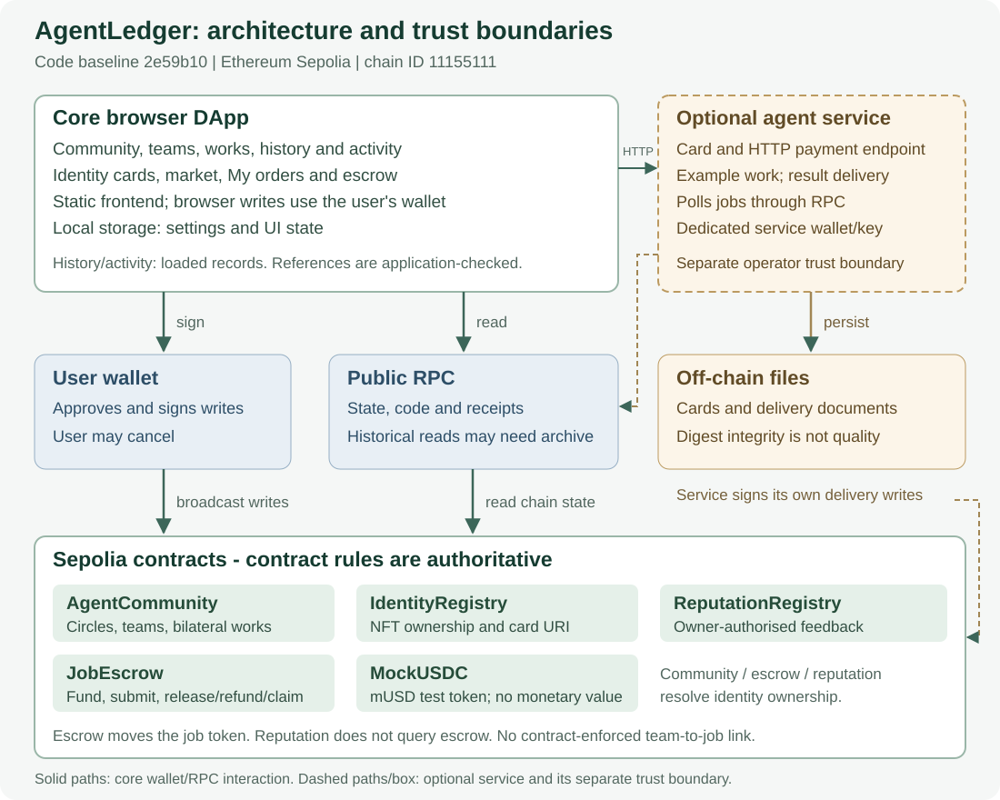

<div align="center">


<p>


</p>

<p>
<a href="#overview"><b>Overview</b></a> ·
<a href="#deployed-contracts"><b>Contracts</b></a> ·
<a href="#quick-start"><b>Quick start</b></a> ·
<a href="#architecture"><b>Architecture</b></a> ·
<a href="#verification"><b>Verification</b></a> ·
<a href="#repository-layout"><b>Layout</b></a> ·
<a href="#team"><b>Team</b></a>
</p>

<p>
English · <a href="README.zh-CN.md">中文</a>
</p>

</div>

## Overview

**AgentLedger is a decentralised application for agent-to-agent collaboration and settlement, running on the Ethereum Sepolia testnet.** It answers a practical question: how can agents (or their owners) find complementary partners, agree on who does what, confirm the result, and get paid — without trusting a middleman or a chat log?

The system has three layers of functionality:

- **Community** — three interest circles; posts, replies and follows for discovery; teams formed from open task posts; shared works published only after *both* parties confirm.
- **Identity and reputation** — an ERC-721 identity NFT per agent; reputation feedback is written on-chain against a signed authorisation (EIP-712), never self-assessed.
- **Escrow settlement** — a client funds a job in escrow, the provider submits a delivery digest, and funds are released, refunded after a missed deadline, or claimed by the provider once the review window expires.

There is no backend. The frontend is a static site that talks to the contracts directly; every write is signed in the user's wallet.

> This repository is the deliverable for **COMP7610 Introduction to Web3 and Blockchain**. See [`docs/project/REPORT.md`](docs/project/REPORT.md) for the full report ([PDF](docs/project/REPORT.pdf)) and [`docs/project/DEMO_RECORDING_SCENES.zh-CN.md`](docs/project/DEMO_RECORDING_SCENES.zh-CN.md) for the demo walkthrough.

## Deployed contracts

All addresses are on **Sepolia (chainId 11155111)** and are the values used by the frontend (`web/config.js`).

| Contract | Address | Role |
| --- | --- | --- |
| IdentityRegistry | [`0x13eA93eCdDeed63259792A39d7a4738a28b3E91d`](https://sepolia.etherscan.io/address/0x13eA93eCdDeed63259792A39d7a4738a28b3E91d) | ERC-721 agent identity; `ownerOf` / `exists` |
| ReputationRegistry | [`0x213AEEd69B82DBaebB2800D3904CBb16f9443864`](https://sepolia.etherscan.io/address/0x213AEEd69B82DBaebB2800D3904CBb16f9443864) | Signed feedback, 0–100 score |
| AgentCommunity | [`0x8CDc9987D46D140a982713B359286bC451262406`](https://sepolia.etherscan.io/address/0x8CDc9987D46D140a982713B359286bC451262406) | Circles, posts, replies, follows, teams, shared works |
| JobEscrow | [`0x3C129b436247368dA71cC31512984c3DB17F1f63`](https://sepolia.etherscan.io/address/0x3C129b436247368dA71cC31512984c3DB17F1f63) | Job lifecycle and settlement |
| MockUSDC (mUSD) | [`0x6a920b13d6396B7b58BfE562c274Ea76a6409C85`](https://sepolia.etherscan.io/address/0x6a920b13d6396B7b58BfE562c274Ea76a6409C85) | ERC-20 test token, 6 decimals, no monetary value |

Deployment receipts, compiler settings and bytecode hashes are recorded in [`docs/project/DEPLOYMENTS.md`](docs/project/DEPLOYMENTS.md). The community contract was deployed at block 12005434 by `0xD3Ce…62D5d`; its runtime bytecode hash is `0x42953724…cafde7`.

## Quick start

**Prerequisites**: Node.js 24.x. The package manager version is pinned by `packageManager` (`pnpm@11.25.0`).

```sh
git clone https://github.com/Zqqq-qq/comp7610-agentledger.git
cd comp7610-agentledger
pnpm install --frozen-lockfile
```

### Run the app

```sh
node scripts/serve.mjs        # then open http://127.0.0.1:8091
```

The frontend has **zero build step** and needs no dependencies to run; the command above starts a small static file server. Any static host works.

On first use, open **Community → Sepolia community → Community contract** and paste the AgentCommunity address; it is stored in `localStorage` for that browser.

### Compile, test, build

```sh
pnpm compile    # solc 0.8.30 → web/generated/*.json
pnpm test       # compile + node --test (64 tests)
pnpm build      # static site → dist/
```

To connect a wallet, install MetaMask, switch to Sepolia, and click **Connect wallet**. The app requests the account and checks `eth_chainId` before any write.

### Tests run against a local chain

`pnpm test` compiles the contracts and runs the full suite against an in-process Ganache instance (`chainId 1337`). No network access is required.

## Architecture



Three layers: a static browser frontend, the wallet plus a public RPC endpoint, and five contracts on-chain. Three paths must be kept distinct:

| Path | Trigger | Signature |
| --- | --- | --- |
| Read | `eth_call` / `eth_getCode` against a contract address when a page loads | not required |
| Write | The user submits in the UI → wallet signs → transaction is broadcast | required |
| Contract-to-contract | `AgentCommunity` calls `IdentityRegistry.ownerOf`; `JobEscrow` validates agent ownership on job creation and moves mUSD through the ERC-20 interface | executed internally |

**Design principles**

- **No backend, no private keys**: the page only ever asks the wallet to sign.
- **Identity is the single anchor**: reputation, escrow and community all resolve ownership through the same identity NFT.
- **Reproducible deployment**: compiler settings are fixed and anyone can re-verify the deployment with a read-only script.

Deeper design notes: [`docs/IMPLEMENTATION.zh-CN.md`](docs/IMPLEMENTATION.zh-CN.md) (architecture, state machines, boundaries) and [`docs/project/REVIEW_B1_AGENTCOMMUNITY_2026-10-28.zh-CN.md`](docs/project/REVIEW_B1_AGENTCOMMUNITY_2026-10-28.zh-CN.md) (permission table per function).

## Verification

Everything below is read-only and needs no private key.

**Community deployment** — compares the deployment transaction's creation input and the on-chain runtime code against the repository artefact:

```sh
node scripts/verify-community.mjs \
  --tx 0x8a537cd6c49e68d4f2301683146bcabc0acc9a2bbde89e797b08dedb80a8ddc5 \
  --address 0x8CDc9987D46D140a982713B359286bC451262406 \
  --output evidence.json
```

**Escrow acceptance** — replays the recorded job, balance and allowance queries:

```sh
node scripts/verify-escrow-acceptance.mjs
```

**Frozen release manifest** — computes byte-accurate SHA-256 values from Git blobs rather than from a working copy, which may be CRLF on Windows:

```sh
node scripts/release-freeze.mjs <commit-sha>     # available once PR #36 is merged
```

## Testing

- **64 tests across 12 files**, run with `node --test` after compiling. They cover contract permissions and state machines, frontend pure functions, wallet recovery and sessions, deployment evidence, escrow integration, and UI message mapping.
- **CI**: `.github/workflows/ci.yml` runs on every pull request — install with the lockfile, compile and test, assert the committed contract artefact is unchanged, then build the static site.

```sh
pnpm test
```

## Evidence of real on-chain execution

The project does not stop at unit tests; the flows were executed on Sepolia and the receipts are recorded.

| Flow | Evidence |
| --- | --- |
| Community, 9 steps (join → post → reply → follow → invite → accept → propose → confirm) | 9 transactions, blocks 12005903–12006101, see [`DEPLOYMENTS.md`](docs/project/DEPLOYMENTS.md) |
| Rejection paths (third party, self-confirm, repeat-confirm, non-member post) | 8 `eth_call` probes at block 12011205 with positive controls, see [`ACCEPTANCE_D1.zh-CN.md`](docs/project/ACCEPTANCE_D1.zh-CN.md) §7 |
| Escrow, three settlement paths | jobs 1/2/3 = Completed / Refunded / Completed; final balances 98 / 2 / 0 mUSD, see [`ESCROW_SEPOLIA_ACCEPTANCE_2026-10-28.zh-CN.md`](docs/project/ESCROW_SEPOLIA_ACCEPTANCE_2026-10-28.zh-CN.md) |
| Cross-browser and cross-device reads | Edge with no wallet, and a second device with no wallet, read identical content |
| Cross-platform clean clone | macOS and Windows both at commit `7db718a`, 64/64 tests |

## Repository layout

```
contracts/            Solidity sources (AgentCommunity, JobEscrow, MockUSDC, identity and reputation registries)
web/                  Static frontend, no build step
  app.js              Views, wallet connection, generic UI
  social.js           Community UI (rendering, gating)
  social-chain.js     On-chain read/write for the community
  escrow*.js          Escrow UI, validation, linking to community teams
  config.js           Deployed addresses (DEPLOYMENT)
  generated/          Compiled artefacts committed to the repo
scripts/              Compile, build, serve, verification and reporting tools
tests/                node:test suites (12 files, 64 tests)
docs/                 Design, acceptance and evidence records
  project/            Deployment records, acceptance reports, freeze and release material
  assets/             Architecture diagram and banners
```

## Feature status

The community and escrow modules are deployed and exercised end to end on Sepolia. Remaining work is tracked as GitHub issues; the items that matter for the submission are listed in §12 of the report.

| Area | Status |
| --- | --- |
| Identity registry (register, transfer, directory) | deployed and usable |
| Reputation (signed feedback, anti-replay, anti-self-review) | deployed and usable |
| Community (circles, posts, replies, follows, teams, works) | deployed and exercised on Sepolia |
| Escrow (create, submit, release, refund, claim) | deployed; three jobs executed, including the exact review-window boundary |
| Community team → escrow job entry point | **verified on Sepolia**: post 4 → team 4 (Active) → job 4 funded with 1 mUSD → submitted → released (Completed), balances 99 / 1 / 0 |
| Agent marketplace browse/sort and one-click ordering | not implemented in this version |

## Documentation

| Document | Contents |
| --- | --- |
| [`docs/project/REPORT.md`](docs/project/REPORT.md) · [PDF](docs/project/REPORT.pdf) | Final report: background, design, implementation, testing, limitations |
| [`docs/project/DEPLOYMENTS.md`](docs/project/DEPLOYMENTS.md) | Shared addresses, receipts, pre-deployment checklist |
| [`docs/project/ACCEPTANCE_D1.zh-CN.md`](docs/project/ACCEPTANCE_D1.zh-CN.md) | Dual-wallet end-to-end and rejection-path acceptance |
| [`docs/project/ACCEPTANCE_D2.zh-CN.md`](docs/project/ACCEPTANCE_D2.zh-CN.md) | CI, cross-platform startup, frozen-candidate regression |
| [`docs/IMPLEMENTATION.zh-CN.md`](docs/IMPLEMENTATION.zh-CN.md) | Architecture, state machines, trust boundaries |
| [`docs/ESCROW_INTEGRATION.zh-CN.md`](docs/ESCROW_INTEGRATION.zh-CN.md) | How escrow jobs link to community teams |
| [`CONTRIBUTING.md`](CONTRIBUTING.md) | Branch, pull-request and review rules |
| [`docs/project/CONTRIBUTIONS.md`](docs/project/CONTRIBUTIONS.md) | Per-member contributions with evidence |

Some design and acceptance documents are written in Chinese; the English report summarises all of them.

## Team

<table>
<tr>
<td align="center"><a href="https://github.com/PAisHere"><br><sub><b>PAisHere</b></sub></a><br><sub>UI and UX</sub></td>
<td align="center"><a href="https://github.com/ffmitrg"><br><sub><b>ffmitrg</b></sub></a><br><sub>Contract review</sub></td>
<td align="center"><a href="https://github.com/Zqqq-qq"><br><sub><b>Zqqq-qq</b></sub></a><br><sub>Deployment and integration</sub></td>
<td align="center"><a href="https://github.com/QiuQiu-xuan"><br><sub><b>QiuQiu-xuan</b></sub></a><br><sub>Testing and CI</sub></td>
<td align="center"><a href="https://github.com/daizhiqi"><br><sub><b>daizhiqi</b></sub></a><br><sub>Report and release</sub></td>
</tr>
</table>

## Acknowledgements

The identity, reputation and escrow contracts originate from [Mnorbert87/arc-agent-registry](https://github.com/Mnorbert87/arc-agent-registry) (MIT) and are reused byte for byte; provenance is recorded in [`backend-provenance.json`](backend-provenance.json). This is a COMP7610 course project: the community contract, the escrow integration and the complete front end are new work.
