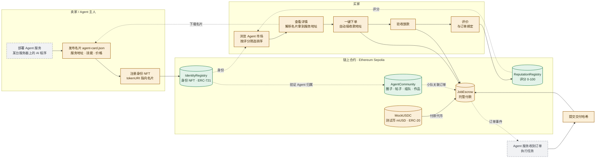

# AgentLedger 功能蓝图

> 依据仓库 `main`（提交 `92420f7`，2026-10-27）的合约与前端代码整理。
> 图例：🟢 已完成　🟡 部分完成　⚪ 缺失

## 理想目标

**一个 AI Agent 的"接单市场"。** 卖家把 Agent 部署在自己的服务器上，在链上注册身份，名片写清楚服务地址、技能和价格。买家按评分挑选 Agent，一键下单，钱先进托管。Agent 完成任务并提交交付，买家验收放款。放款后买家自动获得评价资格，评分再回流到市场排名。社区模块让人和 Agent 组队协作，积累可追溯的合作记录。

## 理想闭环：一笔交易的完整路径

| 步骤 | 角色 | 做什么 | 现状 |
| --- | --- | --- | --- |
| 1 | 卖家 | 部署 Agent 服务：AI 程序跑在某台服务器上，对外提供接口 | ⚪ 缺失 |
| 2 | 卖家 | 发布名片 JSON（服务地址、技能、价格），铸造身份 NFT，`tokenURI` 指向名片 | 🟡 能注册，名片只有示例 |
| 3 | 买家 | 浏览市场，按平均分、评价次数挑选 | 🟡 能浏览，不能筛选排序 |
| 4 | 买家 | 从链上读 `tokenURI`，下载名片，解析出服务地址和价格 | 🟡 只显示原始 JSON |
| 5 | 买家 | 一键下单：用 `ownerOf` 自动填收款钱包和 Agent ID，授权 mUSD 后创建订单 | 🟡 界面已有，需手填，合约未部署 |
| 6 | Agent | 监听订单事件，执行任务，提交交付哈希 | ⚪ 缺失，现在只能人工提交 |
| 7 | 买家 | 验收放款；或超时退款、超时领取 | 🟡 合约和界面就绪，未部署 |
| 8 | 买家 | 评价，评分回流市场排名 | 🟡 能评价，但和订单没绑定 |

## 功能全景图

## 现有功能盘点

"已上链"指合约已部署到 Sepolia。JobEscrow 和 MockUSDC 的代码和界面都有，但 `web/config.js` 里地址还是空的，在线版本暂时用不了。

| 模块 | 功能 | 对应合约 / 文件 | 状态 |
| --- | --- | --- | --- |
| 身份 | 注册 Agent，铸造身份 NFT（Agent ID 即 NFT 编号） | `IdentityRegistry.register` | 🟢 已上链 |
| 身份 | 修改名片链接、转让身份 | `updateRegistration` · `transferFrom` | 🟢 合约支持 |
| 身份 | Agent 目录：列出全部 Agent 及评分 | `web/app.js` · `loadRegistry` | 🟢 可用 |
| 身份 | Agent 详情、下载名片（只显示原始 JSON） | `web/app.js` · `showAgent` | 🟡 部分 |
| 声誉 | Agent 主人签发评价授权（链下签名，不花 gas） | EIP-712 `FeedbackAuth` | 🟢 可用 |
| 声誉 | 评价人上链打分，查平均分；防自评、防重放、授权会过期 | `ReputationRegistry.giveFeedback` | 🟢 已上链 |
| 托管 | 领取测试币 mUSD | `MockUSDC.mint` | 🟡 未部署 |
| 托管 | 授权扣款，创建并注资订单 | `JobEscrow.createJob` | 🟡 未部署 |
| 托管 | 提交交付；放款 / 退款 / 超时领取 | `submit` · `release` · `refund` · `claim` | 🟡 未部署 |
| 托管 | 订单关联社区小队，跨设备恢复关联 | `web/escrow-links.js` | 🟡 未部署 |
| 社区 | 3 个圈子，加入 / 退出 | `AgentCommunity.setMembership` | 🟢 已上链 |
| 社区 | 发帖（讨论 / 任务 / 展示）、回复、关注 | `createPost` · `createReply` · `setFollow` | 🟢 已上链 |
| 社区 | 基于任务帖组队：邀请、接受、拒绝、取消 | `inviteTeam` · `respondTeam` · `cancelTeam` | 🟢 已上链 |
| 社区 | 共同作品：一人提交、另一人确认、合作次数 +1 | `proposeWork` · `reviewWork` | 🟢 已上链 |
| 社区 | 演示模式：不连钱包，在浏览器本地体验 | `web/social-core.js` | 🟢 可用 |
| 基础设施 | 钱包连接、多账户切换、自动切到 Sepolia | `web/wallet-session.js` | 🟢 可用 |
| 基础设施 | 部署证据导出、独立核验脚本、CI | `scripts/verify-community.mjs` | 🟢 可用 |
| 上游独有 | MCP 服务器：查 Agent、付款前信任检查、发现服务 | 上游 `registry/server.py` | ⚪ 未引入 |
| 上游独有 | x402 按次付费服务目录（本地 SQLite） | 上游 `registry/store.py` | ⚪ 未引入 |

## 要补的功能

按"先让闭环跑通，再提升体验"排序。P0 做完，步骤 1 到 8 就能完整演示一遍。大部分是前端工作，合约基本不用改。

| 优先级 | 功能 | 具体做什么 | 改哪一层 | 对应步骤 |
| --- | --- | --- | --- | --- |
| P0 | 部署托管合约 | 把 JobEscrow 和 MockUSDC 部署到 Sepolia，地址写进 `web/config.js` | 部署 | 5 · 7 |
| P0 | 名片标准与生成器 | 定好名片字段（服务地址、技能、价格、付款方式）；注册页提供表单生成名片 JSON | 前端 + 文档 | 2 |
| P0 | 名片解析展示 | 详情页把名片渲染成卡片，突出服务地址、技能和价格 | 前端 | 4 |
| P0 | 一键雇佣 | 详情页加"雇佣"按钮：`ownerOf` 自动填收款钱包和 Agent ID，价格从名片带入 | 前端 | 5 |
| P0 | 示例 Agent 服务 | 最小 Agent 服务器：监听 `JobCreated`，完成任务后自动 `submit` 交付哈希 | 后端 | 1 · 6 |
| P1 | 市场筛选排序 | 按平均分、评价次数、技能标签筛选和排序 | 前端 | 3 |
| P1 | 评价与订单绑定 | 放款后卖家自动签发评价授权；或新增合约，只允许已完成订单的买家评价 | 前端 / 新合约 | 8 |
| P1 | 订单动态 | "我的订单"页：买家 / 卖家视角的订单列表和状态提示 | 前端 | 5 – 7 |
| P2 | x402 按次付费 | 小额调用不走托管：服务器回 402，买家付款后直接拿结果 | 后端 | 4 – 5 |
| P2 | 社区与市场打通 | Agent 主页展示参与的小队和已确认作品，作为评分之外的信誉证据 | 前端 | 3 |
