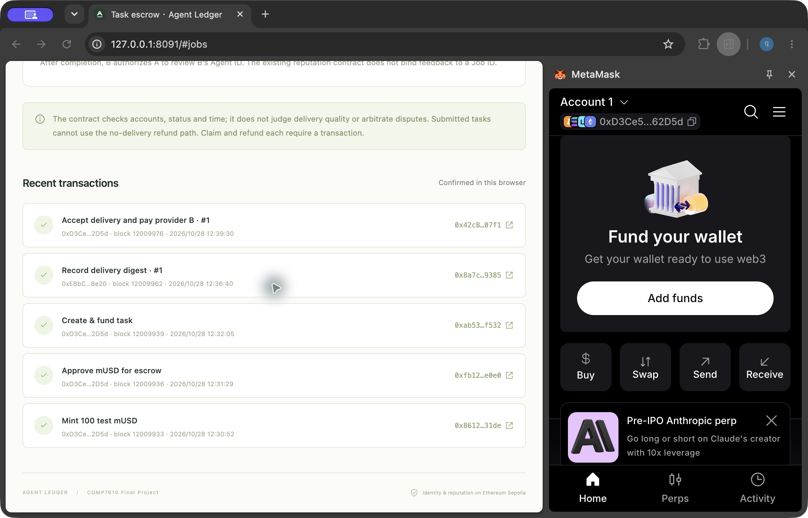
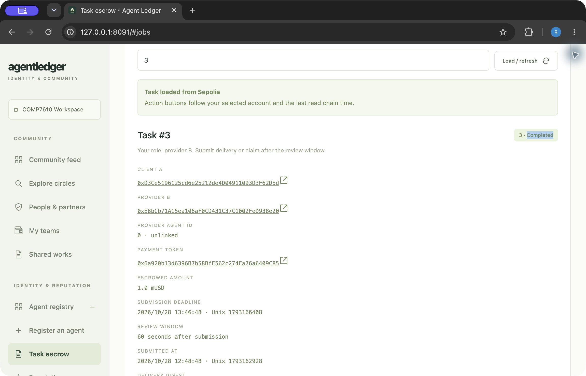
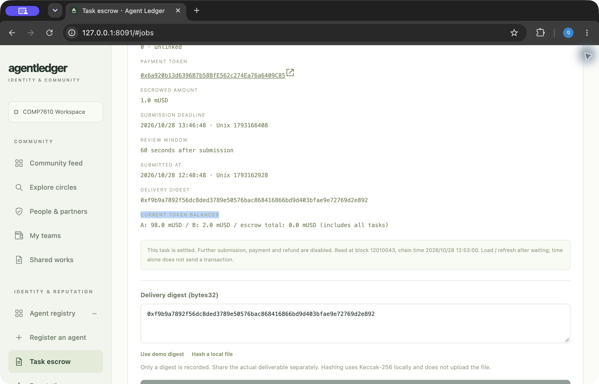

# Sepolia 托管实测验收 · 2026-10-28

Zqqq-qq 亲自在 Chrome / MetaMask 确认全部交易；Codex 辅助准备操作、读取回执、检查状态与余额。仅使用 SepoliaETH 和无货币价值的测试 mUSD。

## 结果

| 路径 | 实际 JobCreated ID | 最终状态 | 资金结果 |
| --- | --- | --- | --- |
| 正常付款 | 1 | Completed (3) | 客户验收后，1 mUSD 付给 B |
| 未交付退款 | 2 | Refunded (4) | 链上超过交付期限后，1 mUSD 退给 A |
| 交付后超时领取 | 3 | Completed (3) | 客户未操作，B 在 60 秒窗口结束后自行领取 1 mUSD |

最终快照：区块 **12010056**，hash `0xb7e9bdf5aaff27cfcb99d69ab90fb4f252b089687b3ff1f8748bc131990846af`。A = **98 mUSD**，B = **2 mUSD**，合约 = **0 mUSD**；两个钱包对托管合约的剩余额度均为 0。初始铸造 100 mUSD，2 笔付款合计 2 mUSD，退款订单无净扣款。

## 部署与账户

- 网络：Ethereum Sepolia，chain ID 11155111。
- RPC：`https://ethereum-sepolia.publicnode.com`。
- 客户 A / Account 1：`0xD3Ce5196125cd6e25212de4D04911093D3F62D5d`。
- 服务方 B / Account 2：`0xE8bCb71A15ea106aF0CD431C37C1002FeD938e20`。
- JobEscrow：`0x3C129b436247368dA71cC31512984c3DB17F1f63`。
- MockUSDC：`0x6a920b13d6396B7b58BfE562c274Ea76a6409C85`（mUSD，6 位小数）。
- identity() 指向既有 IdentityRegistry `0x13eA93eCdDeed63259792A39d7a4738a28b3E91d`，ReputationRegistry 沿用原地址。

## 14 笔交易回执

| 操作 | 区块 | 哈希 |
| --- | --- | --- |
| deploy-mockusdc | 12009909 | [0x45673f45fa0c9b156bb276b8e113213369ffc19e2295f14cc9384211d9929dd3](https://sepolia.etherscan.io/tx/0x45673f45fa0c9b156bb276b8e113213369ffc19e2295f14cc9384211d9929dd3) |
| deploy-escrow | 12009914 | [0x3a35a1d2409018d5f9b14d3be7d3f9fc3a113467d9d6407f75125c5c2fa1170d](https://sepolia.etherscan.io/tx/0x3a35a1d2409018d5f9b14d3be7d3f9fc3a113467d9d6407f75125c5c2fa1170d) |
| mint | 12009933 | [0x86129805c86ecaffb17e69d1db8e158ce5b86cd61b0aa4a178c63d8e127931de](https://sepolia.etherscan.io/tx/0x86129805c86ecaffb17e69d1db8e158ce5b86cd61b0aa4a178c63d8e127931de) |
| approve-job1 | 12009936 | [0xfb12a841747381d11302ef1763666ccc6666785cab56fbdbda1cf039e165e0e0](https://sepolia.etherscan.io/tx/0xfb12a841747381d11302ef1763666ccc6666785cab56fbdbda1cf039e165e0e0) |
| fund-job1 | 12009939 | [0xab535a6b10d6f1b04616069295a75c23278fb667671c59265aa8c3a056dcf532](https://sepolia.etherscan.io/tx/0xab535a6b10d6f1b04616069295a75c23278fb667671c59265aa8c3a056dcf532) |
| submit-job1 | 12009962 | [0x8a7c020fb63fa3a07c2e8703b7fe62ce65167bf52e2665bb78be105585859385](https://sepolia.etherscan.io/tx/0x8a7c020fb63fa3a07c2e8703b7fe62ce65167bf52e2665bb78be105585859385) |
| release-job1 | 12009976 | [0x42c80407fe5d811887316c4b5b290b896c81abd0d018e022db17d58d6c7c07f1](https://sepolia.etherscan.io/tx/0x42c80407fe5d811887316c4b5b290b896c81abd0d018e022db17d58d6c7c07f1) |
| approve-job2 | 12009982 | [0x044aecdb4577b0edf97a5088ee259cfe3b3807668b0294b1834547cd9720c9a6](https://sepolia.etherscan.io/tx/0x044aecdb4577b0edf97a5088ee259cfe3b3807668b0294b1834547cd9720c9a6) |
| fund-job2 | 12009985 | [0x6ae20b9d1d5fbf9bc14e3ff075f298aebff8daa72da5d90bdd718358d7020119](https://sepolia.etherscan.io/tx/0x6ae20b9d1d5fbf9bc14e3ff075f298aebff8daa72da5d90bdd718358d7020119) |
| refund-job2 | 12010005 | [0xa8fb20cab443390c24f86cd83792cb6fcc097382ef99b3861f94dca203a65d36](https://sepolia.etherscan.io/tx/0xa8fb20cab443390c24f86cd83792cb6fcc097382ef99b3861f94dca203a65d36) |
| approve-job3 | 12010011 | [0x204af299e265f35c37190916855bcea57446248c48d4d09a33eb10cac761b3c6](https://sepolia.etherscan.io/tx/0x204af299e265f35c37190916855bcea57446248c48d4d09a33eb10cac761b3c6) |
| fund-job3 | 12010015 | [0xafc87f1a84818f3817d00c1835ae9788d5f6071f51c6140acc7070990265cf96](https://sepolia.etherscan.io/tx/0xafc87f1a84818f3817d00c1835ae9788d5f6071f51c6140acc7070990265cf96) |
| submit-job3 | 12010022 | [0xe077da083f1079acb7a5cdc22f6fe3d12be0d21aae5d9b46a90576133f66f48e](https://sepolia.etherscan.io/tx/0xe077da083f1079acb7a5cdc22f6fe3d12be0d21aae5d9b46a90576133f66f48e) |
| claim-job3 | 12010043 | [0x6b8fafe725e5b268b55cd5758889085bb58cff6f6628b59ffbe01650d7c10e1e](https://sepolia.etherscan.io/tx/0x6b8fafe725e5b268b55cd5758889085bb58cff6f6628b59ffbe01650d7c10e1e) |

原始回执、完整 JSON-RPC 参数与响应、固定高度的订单/余额/额度、部署创建输入与运行时比对，见 [机器证据](evidence/escrow-sepolia-acceptance.json)。调用结果不只依赖界面成功提示。

## 时间限制与重复结算

- 订单 2 的截止时间为北京时间 12:42:48（Unix 1793162568）。在到期前固定区块调用退款，返回 `deadline not passed`；严格过期后同角色调用可执行，随后真实退款交易成功。
- 订单 3 的交付时间为 12:48:48（Unix 1793162928），窗口为 60 秒。区块 12010027 的时间恰好等于 12:49:48，claim 仍返回 `review window open`；更晚区块的只读调用成功，随后真实 claim 交易成功。
- 结算后再次模拟 release(1)、refund(2)、claim(3) 均被合约拒绝。未为重复结算额外发送消耗测试币的失败交易。
- 完整调用参数、固定区块哈希、原始 revert data 见 [退款前探针](evidence/job2-funded-refund-probe.json)、[退款资格探针](evidence/job2-refund-eligible-probe.json)、[提前领取探针](evidence/job3-submitted-claim-probe.json)、[严格边界探针](evidence/job3-claim-strict-boundary.json)。

## 源码、编译与复现

本次部署使用基线 `583fd6d1a1932a56c508d1faef617868e8ccb85c` 中未修改的合约。部署后 main 合入换行规范化：JobEscrow 由 CRLF 转 LF，逻辑相同但 solc metadata / 字节码会改变。因此保留实际部署的 [原始源码 JSON 快照](evidence/escrow-deployment-sources.json)，不修改 main 的规范化源码。

- JobEscrow 原始 Git blob：`356be8068d8f34502966b5ddab682fb332b23600`。
- MockUSDC 原始 Git blob：`6465fb72e58288e7fef2a654a7f46f1b3e7b64f5`。
- solc 0.8.30；optimizer runs 200；viaIR true；EVM Shanghai。
- scripts/compile-escrow.mjs 使用快照的确切字节，检查与当前源码规范化后相同，再编译生成部署产物。运行时代码核验按照 immutableReferences 回填 identity 的 32 字节地址。

```sh
pnpm install --frozen-lockfile
node scripts/compile-escrow.mjs
node scripts/verify-escrow-acceptance.mjs /tmp/escrow-audit.json
pnpm test
pnpm build
```

核验脚本仅允许只读 RPC，无钱包、密钥、签名或广播。SEPOLIA_RPC_URL 可指定保留历史状态的公共节点；若旧区块已不可读，脚本明确失败，不会把 latest 写作旧结果。每次输出记录自身的新固定快照。未声称 Etherscan 已发布认证源码。

## 界面证据

以下为真实浏览器截图；订单界面的当前余额取自截图时刻，历史资金变化以固定区块 JSON 为准。







验证结果：与最新 main 对齐后，本地 **61 项测试通过**，静态构建通过；部署源码快照重编译与 14 笔只读核验均通过。

## 本轮范围与交接

- 三个订单的 providerAgentId 均为 **0（unlinked）**。本轮验收的是双钱包托管资金路径，不将它写成 Agent 身份绑定或社区小队引用的真实公链验收。相关校验保留已有本地真实 EVM 测试；本轮未额外发布小队引用。
- 实际交付文件：[订单 1](evidence/job1-deliverable.md)、[订单 3](evidence/job3-deliverable.md)。链上只存 Keccak-256 摘要，摘要不证明内容质量。
- 交易签名由 Chrome 的两个账户完成；随后内置浏览器在未连接钱包的状态下，独立读取同一合约的 Job 1/2/3，均显示相同终态及最终余额。此项是跨浏览器只读检查，不冒充第二浏览器签名或另一位组员人工复核。
- 独立读取截图：[Job 1](evidence/escrow-screenshots/independent-job1-completed.png)、[Job 2](evidence/escrow-screenshots/independent-job2-refunded.png)、[Job 3](evidence/escrow-screenshots/independent-job3-completed.png)。
- 尚无仲裁、多人分账、已提交后的拒收退款；共同作品确认不自动放款；评价也未与 jobId 合约绑定。
- 本次完成 #12 剩余资金实测条件。待同伴审阅本报告与提交、CI 通过并合并后再关闭 #12；#5 / #7 各自剩余验收不由此替代。
