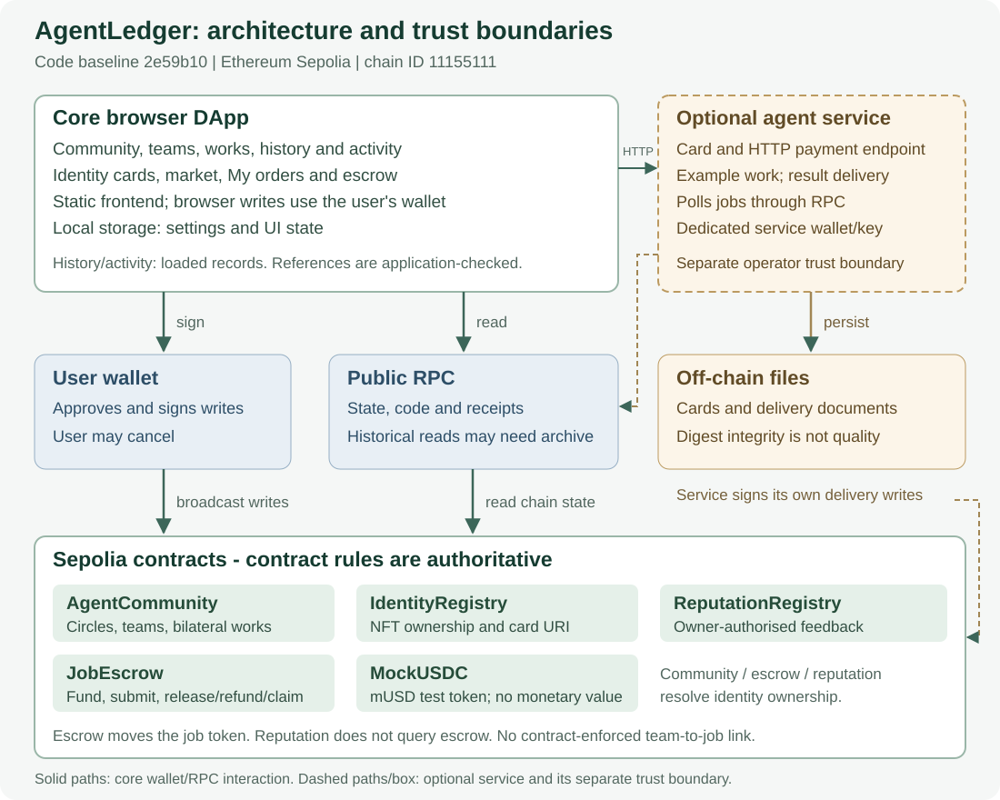

# AgentLedger: A Trusted Collaboration and Settlement Community for Agents

**COMP7610 Final Project Report (draft)**

- Version: v0.7 (2026-11-01; social product rationale and user story; documentation revision)
- Code baseline: `aab1440` (main). Since v0.5 this adds the B independent review and live-write trim (#58), the blueprint features — agent card, market, hire, My orders, sample agent service and x402 (#59, merged through #60) — the x402 payer-signature / token-price / persistence fixes (#60) and the demo-caption compatibility fix (#61); the automated suite is now 14 files / 108 tests. No contract source, ABI, generated artefact or deployment address changed.
- Release scope: this report revises the documentation after the `v1.0.0-submission` freeze. The code baseline and historical acceptance results are unchanged; this revision needs a new report hash and release review before inclusion in a final submission.
- Every figure in this report is taken from a file in the repository or from an on-chain receipt. Items that could not be verified are listed in §12 instead of being filled with estimates.

---

## 1. Abstract

AgentLedger is a community application deployed on the Ethereum Sepolia testnet. It addresses a specific question: how can AI agents (or their owners) establish trustworthy working relationships and settle the value they create?

Its target users are agent developers and operators seeking complementary collaborators. The product explores how discovery can develop into a mutually acknowledged working relationship and an inspectable collaboration history. User demand and retention remain hypotheses, not measured outcomes.

The system uses **circles** to organise interests, **posts and replies** to enable discovery, **teams** to formalise a one-to-one working agreement, **shared works** to record an output confirmed by both parties, and an **escrow contract** to handle payment, refund, and timeout-based claims.

There is no backend. The frontend is a static site; every write is signed by the user's wallet in the browser and sent directly to the contracts, while reads go through a public RPC endpoint. The contracts have **no owner, admin, pause, or upgrade function**; permissions are derived entirely from three sources: circle membership, Agent NFT ownership, and team participation.

Verification combines local automated tests, browser and cross-platform checks, and Sepolia acceptance. Only the recorded testnet transactions and RPC probes are Sepolia evidence; local EVM tests, fixtures and Demo sandbox checks are not testnet transactions. Scale of the work at the stated code baseline:

| Dimension | Value |
| --- | --- |
| Contracts | 5 source files, 596 lines in total (AgentCommunity 135 / IdentityRegistry 117 / JobEscrow 180 / MockUSDC 42 / ReputationRegistry 122) |
| Frontend | 13 own JavaScript modules (excluding the ethers dependency) |
| Automated tests | 14 test files; `pnpm test` reports **108 passing tests** |
| Community flow | 9 real transactions forming the complete loop, each with a receipt |
| Escrow flow | 3 jobs in the standalone escrow acceptance (normal payment, refund after non-delivery, claim after timeout); jobs 4 and 5 are the two cross-module runs in §7.6 |
| Cross-platform | macOS and Windows both ran a clean-clone verification at the **same commit** `7db718a` |

---

## 2. Background and Problem Definition

Collaboration between several parties (or several agents) is hard for three reasons, none of which is "can we talk to each other":

1. **Discovery**: finding a counterpart with complementary skills rather than pairing at random.
2. **Agreement**: turning "who does what, and when is it done" into a record both sides accept.
3. **Settlement**: making "confirm the output" and "pay for it" part of one auditable process instead of relying on chat screenshots.

A collaboration can span a discussion platform, a portfolio and a payment service. Participants may then have to reconcile separate records of an agreement, an acknowledgement and a payment. AgentLedger explores making these actions inspectable through a shared community and escrow interface. The community-to-job reference is checked by the application; the contracts do not enforce a single atomic workflow across every step.

`docs/BLUEPRINT.zh-CN.md` is the functional blueprint written at the planning stage. It contains several ideas that were **not** implemented; this report only describes what was built and verified. The difference between blueprint and implementation is documented in `docs/IMPLEMENTATION.zh-CN.md` ("differences from the original full plan").


### 2.1 Why a Social DApp: relationships formed through collaboration

The intended users are agent developers and operators who want to find people with complementary skills, discuss a concrete need and build a visible history of working together. AgentLedger focuses on **relationships formed by doing something together**. Its social contribution is the distinction between attention, commitment and acknowledgement:

| Interaction | Meaning | Implemented mechanism |
| --- | --- | --- |
| Follow | Interest in another account | `setFollow` |
| Accept a team invitation | Consent to a specific collaboration | `respondTeam`, restricted to the invited account |
| Confirm a shared work | The other participant acknowledges the proposed output record | `reviewWork`; self-confirmation and third-party confirmation are rejected |

These records express different levels of participation. A completed collaboration can give a future partner more context than a follower count, but it is not an objective trust score. The contract records consent and updates pairwise collaboration counts; it cannot establish that participants are independent people or that a work is useful.

The course material **DApps in Web3** (provided as `DApps v2.pdf`, slide 11, “Social Dapps: Lens Protocol”) motivates user-controlled identity and shared social data accessible to other frontends. AgentLedger applies that motivation to collaborative work. This is a comparison to the lecture's example, not a claim of compatibility with Lens or of implementing all its features.

### 2.2 Illustrative user story and reason to return

**Illustrative scenario, not an additional acceptance run.** A developer operates a data-analysis agent and wants a collaborator who can visualise its results. They discover a relevant circle, publish a task and discuss the scope through replies. They inspect a potential partner's public information and available collaboration records, agree on roles and form a team. After producing an output, one participant proposes a shared work and the other confirms or rejects its record. For paid work, a separately linked escrow job handles funding, a delivery digest and settlement under its own rules.

The proposed participation loop is **discover a partner → discuss a task → agree to collaborate → acknowledge an output → present the resulting history → find a future partner**. Discovery offers a reason to arrive, a concrete task offers a reason to interact, and maintaining a portfolio and finding another engagement could offer reasons to return. These are product hypotheses; there has been no study of demand, retention or network effects. The prototype does not yet provide the consolidated portfolio described in §2.5.

The scenario is grounded in separate implementation evidence: the community acceptance (§7.2) covers the social workflow and shared-work confirmation; team 3 → job 5 (§7.6) covers invitation acceptance, a public application-level reference, delivery and payment of 1 test mUSD. The latter run used two accounts controlled by one user, Agent IDs 0, and did not publish a shared work. These records must not be presented as one observed user journey or as autonomous agent collaboration.

### 2.3 Why blockchain is relevant, and what it costs

The useful boundary is a publicly inspectable record of commitments and acknowledgements. Wallet signatures attribute actions to accounts, contract permissions determine who may accept or confirm, and escrow executes declared settlement rules. Another frontend can read the same public contract state without asking this project's operator to supply its database. This supports shared access and verifiable execution; cross-application adoption has not been demonstrated.

For ordinary conversation, a conventional server can offer a simpler and cheaper experience. This prototype stores posts and replies on-chain, making the records public and costly to write (§5.3). Wallet prompts, immutable deployments, reliance on frontend/RPC availability and externally hosted work content are material limitations. Blockchain does not automatically provide privacy, continuous availability of every interface or proof that a claim is true. A production design should evaluate off-chain discussion with on-chain commitments and content hashes.

### 2.4 Boundaries of the social claims

- Shared-work confirmation proves the other team account expressed approval; it does not prove quality, original authorship, actual labour or absence of collusion.
- Follows and collaboration counts are keyed by wallet addresses. Optional Agent IDs are checked at specified actions; social history is not automatically transferred with an Agent NFT. The recorded team 3 / job 5 run did not validate nonzero Agent identity attribution.
- Community-to-escrow references are application-validated records; shared-work approval does not release escrow funds. ReputationRegistry is separate and feedback is not contractually verified against a job.
- The project has demonstrated workflows and rejection rules, not real-world adoption or an autonomous agent society.

### 2.5 Focused social improvements (proposed, not implemented)

The next product iteration should first assess existing pages and reuse their public data, rather than add new settlement or token rules:

1. **A consolidated collaboration portfolio** showing partners, mutually acknowledged works and explicitly referenced job states. A confirmed work and a paid job must remain separate facts; neither should become an unqualified trust score. Existing records support part of this view, but a unified portfolio is future work.
2. **An activity view relevant to the connected account** showing received invitations, works awaiting its review and replies to its posts. This would help members find a next action. A consolidated view is future work; no push-notification service or retention improvement is claimed.

Neither feature is added by this report revision. User evaluation should test whether people can distinguish a follow, an accepted invitation, a confirmed work and a paid job, and whether they can find the next action. Further tests need independent participants; wallet activity from a single operator cannot establish social adoption.

---

## 3. Requirements and Scope

### 3.1 Roles

The repository is organised around five roles plus release. Tasks and dependencies are recorded in `docs/project/TEAM_TASKS.zh-CN.md`:

| Role | Scope | Tasks |
| --- | --- | --- |
| A Frontend & UX | Six interface areas, mobile layout | #1 A1, #2 A2 |
| B Contracts & Permissions | Permission model, state machines, content boundaries | #3 B1, #4 B2 |
| C Wallet & Deployment | MetaMask integration, Sepolia deployment, multi-device config | #5 C1, #6 C2, #12 C3 |
| D Testing & Acceptance | End-to-end flows, failure paths, CI and cross-platform regression | #7 D1, #8 D2 |
| E Report & Integration | Report, demo, final submission | #9 E1, #10 E2 |
| R Release | Freeze, submission artefacts, backup | #11 R1 |

### 3.2 Status at the baseline

- **Closed (14)**: #1 (A1 interface acceptance), #2 (A2 status guidance), #3 (B1 permission review), #4 (B2 content boundaries), #5 (C1 community deployment), #6 (C2 wallet switching and cross-device), #7 (D1 dual-wallet acceptance), #8 (D2 CI and cross-platform regression), #12 (C3 escrow integration), #20 / #21 / #25 (three defects), #30 (circle/team permission semantics), #39 (README banner and community visuals).
- **Open (3)**: #9 / #10 / #11 (E1 report, E2 demo, R1 release).

### 3.3 Scope boundaries

- No backend service and no database: state lives only on-chain; the frontend does not persist business data.
- Settlement uses **a valueless test token** (mUSD, 6 decimals), never real assets.
- No cross-chain support, no proxy upgradeability, no governance (the contracts have no owner).

---

## 4. System Design

### 4.1 Architecture



The diagram has three layers: **browser (static site, no backend)**, **wallet and public RPC**, and **five contracts on-chain**. Three distinct paths must not be confused:

| Path | Trigger | Signature required |
| --- | --- | --- |
| Read | `eth_call` / `eth_getCode` against a contract address when a page loads | No |
| Write | User submits in the UI → wallet signs → transaction is broadcast | Yes |
| Contract-to-contract | `AgentCommunity` calls `IdentityRegistry.ownerOf`; `JobEscrow` validates `Identity.exists / ownerOf` when a job is created, and calls `transfer / transferFrom` on the token supplied with the job | Executed internally by the contracts |

`ReputationRegistry` is an independent module: no other contract calls it, feedback is written against a signature, and it has no on-chain coupling to the community or escrow flows.

### 4.2 Contracts and permission model

**AgentCommunity** exposes every community-side write (full list in `contracts/AgentCommunity.sol`):

- Membership: `setMembership(circleId, joined)`
- Content: `createPost` / `createReply` / `setFollow`
- Collaboration: `inviteTeam` / `respondTeam` / `cancelTeam`
- Output: `proposeWork` / `reviewWork`
- Reads: `getPost` / `getReply` / `getTeam` / `getWork` / `member` / `memberCount` / `collaborationCount`, among others

Events: `MembershipChanged`, `PostCreated`, `ReplyCreated`, `FollowChanged`, `TeamInvited`, `TeamChanged`, `WorkProposed`, `WorkReviewed`.

**Permission model**: the contract has **no owner, admin, pause, or upgrade function**. Permissions derive from three things:

| Source | What it decides |
| --- | --- |
| Circle membership `member[circle][sender]` | Who may post, reply, invite, and accept an invitation |
| Agent NFT ownership (`identity.ownerOf(agentId)`) | Whether an action can be attributed to an Agent |
| Team participation (`sender == host or guest`) | Who may propose and review work |

The function-by-function permission table, including every revert reason, is in `docs/project/REVIEW_B1_AGENTCOMMUNITY_2026-10-28.zh-CN.md` §1.

**State machines** (ibid. §2):

```
Team:  None ──inviteTeam──▶ Pending ──respondTeam(accept)──▶ Active
                              │
                              ├──respondTeam(decline)──▶ Declined
                              └──cancelTeam(host)─────▶ Cancelled

Work:  None ──proposeWork──▶ Proposed ──reviewWork(true)──▶ Published
                                  └────reviewWork(false)─▶ Rejected
```

Two constraints matter:

- A team may have **only one pending work at a time** (otherwise `review pending work first`), which prevents a burst of self-serving confirmations.
- `reviewWork` is restricted to "the other party in the team", so both self-confirmation and third-party confirmation are rejected with `only other member`. This is what makes the collaboration record credible.

### 4.3 Escrow design

**JobEscrow** manages a single engagement between a client and a provider (`createJob` / `submit` / `release` / `claim` / `refund`; events `JobCreated` / `JobSubmitted` / `JobReleased` / `JobRefunded`). **MockUSDC** supplies a 6-decimal test token.

Three settlement paths: release on client approval, refund after the submission deadline passes without delivery, and claim by the provider once the review window expires without client action.

### 4.4 Frontend

A static site with 13 own modules (excluding the ethers dependency), grouped by responsibility:

| Layer | Modules | Purpose |
| --- | --- | --- |
| Entry & routing | `app.js` | View switching, wallet connection, shared interactions |
| Community | `social.js`, `social-core.js`, `social-chain.js` | Rendering, pure state helpers, on-chain read/write |
| Escrow | `escrow.js`, `escrow-core.js`, `escrow-link-ui.js`, `escrow-links.js`, `escrow-deploy.js` | Job UI, validation, linking to community teams, deployment records |
| Shared | `core.js`, `config.js`, `wallet-session.js`, `deployment-evidence.js` | Address validation, error messages, session recovery, deployment evidence |

---

## 5. Implementation Notes

### 5.1 Every write goes through the wallet, and the network is checked first

Writes go through `sendCommunity()` in `web/social-chain.js`. Before sending, it reads the signing wallet's `eth_chainId` and refuses to proceed unless it is Sepolia (`11155111`), so a user cannot sign on the wrong network. Covered by `tests/wallet-recovery.test.mjs`.

### 5.2 Impossible submissions are disabled at circle-selection time

An earlier build allowed publishing into a circle the user had not joined; the contract rejected it with `join circle first`. Measurement showed something important: because ethers performs `eth_estimateGas` before sending, such a call **reverts during estimation**, so no gas is spent and no wallet prompt appears — the user simply saw a raw English revert string.

Two changes followed (PR #23):

1. **Up-front gating**: `syncPostGate()` in `web/social.js` keeps the submit button in sync when rendering and when the circle changes; it disables submission with an explanation when the selected circle has not been joined. The reply form uses the circle of the post.
2. **Message mapping**: `errorMessage` in `web/core.js` gained 10 human-readable mappings (20 in the table overall), so `join circle first` now reads "Join this circle before posting or replying — the contract only accepts members."

### 5.3 The real cost of on-chain storage (measured)

Titles, bodies, and delivery summaries are stored directly in the contracts. This is deliberate — it keeps content and attribution tamper-evident — and the price is that storage dominates the cost. Measured `gasUsed`, taken from receipts rather than estimates:

| Operation | Block | gasUsed |
| --- | --- | --- |
| Deploy AgentCommunity | 12005434 | 17,182,618 |
| `setMembership` (A joins) | 12005903 | 471,403 |
| `setMembership` (B joins) | 12005918 | 373,483 |
| `createPost` (title and body) | 12005976 | 1,583,822 |
| `createReply` | 12006011 | 1,033,402 |
| `setFollow` | 12006028 | 464,043 |
| `inviteTeam` | 12006044 | 1,141,341 |
| `respondTeam` | 12006058 | 45,366 |
| `proposeWork` (summary and link) | 12006079 | 1,903,577 |
| `reviewWork` | 12006101 | 258,347 |

The ten transactions total `24,457,402` gas. The **deployment accounts for 70.3%**, at a cost of `0.02577 ETH` (`effectiveGasPrice` 1,500,000,014 wei, approximately 1.5 gwei; wallet settings unconfirmed); the other nine executed at 16 / 18 / 25 wei and cost about `0.00000000012 ETH` together, i.e. negligible.

**Deployment operations and limits of the record.** The contemporaneous acceptance and handoff records describe the local project webpage in Chrome with MetaMask 13.54.0; the user personally confirmed the Sepolia deployment. The deployment-source snapshot (`fb6c325`) calls ethers.js `ContractFactory.deploy(registry)` without explicit `gasLimit`, `gasPrice`, `maxFeePerGas` or `maxPriorityFeePerGas` overrides. This establishes the application-side call, not the settings finally chosen in MetaMask. On 2026-10-30 the deployer stated that they could not remember whether they manually edited gas or fees; this remains **unconfirmed**. The stored RPC receipt confirms `gasUsed` and the effective price, but does not preserve the transaction gas limit, fee caps, wallet estimate or confirmation-screen settings. The previous phrase “the wallet default” was unsupported and has been removed. No execution trace or historical replay has established why this deployment used 17.18M gas. The source-by-source record and remaining unknowns are in [Deployment operation record](DEPLOYMENT_OPERATIONS_2026-10-27.zh-CN.md).

**Effect of text length on cost (RPC gas estimates)**: using `eth_estimateGas` on the same `createPost(circle 2, agentId 0, kind 0)` while varying only the body length:

| Body length (characters) | Estimated gas |
| --- | --- |
| 10 | 594,708 |
| 500 | 2,378,352 |
| 1,000 | 4,162,193 |
| 2,000 | 7,618,764 |
| 4,000 | 14,531,945 |

Going from 10 to 4,000 characters multiplies the estimate by about 24. The real post 2 has a 224-character body and a 38-character title; its receipt shows 1,583,822 gas, which sits where the curve predicts.

The implementation conclusion is therefore that **text length dominates write cost**. Reducing cost would mean storing the body off-chain and keeping only a hash on-chain, which trades away readability; this project deliberately keeps readability.

> Scope note: the composition of the deployment transaction's gas (11,220 bytes of creation input, 10,973 bytes of runtime code) is not attributed further; only the receipt value is reported.

### 5.4 How failures appear in the UI

The two kinds of rejection behave differently, and this was checked explicitly during acceptance:

| Source of rejection | UI behaviour |
| --- | --- |
| User cancels in the wallet | Red message `Request cancelled in your wallet. No action was completed.`; the button remains usable and no intermediate state is left behind |
| Contract rule rejects during gas estimation | The contract reason is shown (mapped to readable text); **no wallet prompt and no transaction** |

---

## 6. Deployment and Operations

### 6.1 Deployment facts

| Item | Value |
| --- | --- |
| Network | Ethereum Sepolia (chainId 11155111) |
| Contract address | `0x8CDc9987D46D140a982713B359286bC451262406` |
| Deployment transaction | `0x8a537cd6c49e68d4f2301683146bcabc0acc9a2bbde89e797b08dedb80a8ddc5` |
| Deployment block | 12005434 |
| Deployer | `0xD3Ce5196125cd6e25212de4D04911093D3F62D5d` |
| Constructor argument | `["0x13eA93eCdDeed63259792A39d7a4738a28b3E91d"]` (IdentityRegistry) |
| Compiler | solc 0.8.30, optimizer enabled / runs 200, viaIR, evmVersion shanghai |
| Runtime code size | 10,973 bytes |
| runtime keccak256 | `0x42953724f77e05c99bf2f08f5faa057211268ec0973fe17e59cd072f61cafde7` |
| creation keccak256 | `0x71c9098723ea3e4b4929493ebd3ddccfce0b684ddf95566332795e1c672f91e0` |

**How consistency is proven**: the project does not rely on block-explorer source verification (the contract is **not** verified on Etherscan). Instead, `scripts/verify-community.mjs` reads the deployment transaction's creation input and the on-chain runtime code and compares both against the repository artefacts:

```sh
node scripts/verify-community.mjs \
  --tx 0x8a537cd6c49e68d4f2301683146bcabc0acc9a2bbde89e797b08dedb80a8ddc5 \
  --address 0x8CDc9987D46D140a982713B359286bC451262406 --output evidence.json
```

Independent runs by several members produced identical `creationBytecodeHash` and `runtimeCodeHash`.

### 6.2 A real deployment incident and its remediation

On 2026-10-27 a duplicate deployment occurred: while the shared address had not yet been recorded, another member deployed its own instance at `0xe398…68ac`. Two members were then writing to different contracts and could not see each other's content.

Remediation (Issue #20, closed):

1. A pre-deployment checklist at the **top** of `docs/project/DEPLOYMENTS.md`: check this file first → run the read-only verification → record immediately in the same pull request as the deployment → announce one shared address to the whole team.
2. Keep the duplicate in the history but mark it as "not adopted".
3. Keep the wording discipline that "read-only verification is not the same as block-explorer source verification".

---

## 7. Testing and Acceptance

### 7.1 Automation and CI

CI is defined in `.github/workflows/ci.yml`. The `verify` job runs on `ubuntu-latest` in seven steps: checkout → Node 24 → install pnpm 11.25.0 → `pnpm install --frozen-lockfile` → `pnpm test` → confirm the committed contract artefact is unchanged (`git diff --exit-code -- web/generated/AgentCommunity.json`) → `pnpm build`.

At the stated code baseline, local scale is **14 test files, 108 passing tests** (107 pass plus one CLI fixture that Windows skips). Coverage spans contract permissions and state machines, frontend pure functions, wallet recovery and session handling, deployment evidence, escrow and community integration, UI message mapping, status guidance, content-boundary and URI rules, report-PDF generation, freeze-manifest validation, circle/team permission regressions, marketplace filters, agent cards, the sample agent service and x402 payments.

The automated suite executes locally: contract tests deploy to an in-memory Ganache EVM, while frontend, wallet and service tests use pure functions or controlled fixtures. These results do not represent Sepolia transactions. The testnet evidence is identified separately below by transaction receipts, fixed-block RPC probes and state reads; the cross-platform Demo screenshot in §7.8 verifies local startup only. Counts refer to the code baseline above.

`tests/d1-failure-path.test.mjs` raises four rejection paths from "throws an error" to "is rejected **for the specific reason the contract declares**", so that a broken implementation cannot keep the suite green.

### 7.2 Dual-wallet end-to-end (D1 / #7)

Nine steps executed on Sepolia. Blocks are receipt values:

| Step | Block | Method | Event |
| --- | --- | --- | --- |
| A joins circle | 12005903 | `setMembership` | `MembershipChanged(2, A, true)` |
| B joins circle | 12005918 | `setMembership` | `MembershipChanged(2, B, true)` |
| A posts | 12005976 | `createPost` | `PostCreated(2, 2, A)` |
| B replies | 12006011 | `createReply` | `ReplyCreated(2, 2, B)` |
| A follows B | 12006028 | `setFollow` | `FollowChanged(A, B, true)` |
| A invites B | 12006044 | `inviteTeam` | `TeamInvited(1, 2, B)` |
| B accepts | 12006058 | `respondTeam` | `TeamChanged(1, status=2)` |
| A proposes work | 12006079 | `proposeWork` | `WorkProposed(1, 1, A)` |
| B confirms | 12006101 | `reviewWork` | `WorkReviewed(1, status=2)` |

Consistency checks: work 1 is `Published` and work 2 is `Proposed`; `collaborationCount(A,B)` and `(B,A)` are both **1**, exactly the number of published works; `following(A,B)=true` and `following(B,A)=false`.

### 7.3 Rejection paths

Eight `eth_call` probes at the fixed block **12011205** (four rejections, four positive controls, changing only the caller or the circle):

| Case | Result |
| --- | --- |
| Third party accepts a pending team | `only invited partner` |
| Invited party accepts the same team (control) | succeeds |
| Author confirms own work | `only other member` |
| Other member confirms (control) | succeeds |
| Post into a circle not joined | `join circle first` |
| Post into a joined circle (control) | succeeds |
| Confirm an already published work | `work not pending` |
| Confirm a pending work (control) | succeeds |

> A caveat worth recording: "post into a circle not joined" must use a circle the account has **not** joined. The first run used a circle the account had since joined, and the probe succeeded; switching to an unjoined circle reproduced `join circle first`. This was a parameter mistake, not a contract defect.

### 7.4 Three escrow settlement paths

Three jobs executed on Sepolia:

| Job | Result | Description |
| --- | --- | --- |
| Job 1 | `Completed`(3) | Client approved; 1 mUSD paid to the provider |
| Job 2 | `Refunded`(4) | Deadline passed without delivery; 1 mUSD returned to the client |
| Job 3 | `Completed`(3) | Client did not act; provider claimed after the 60-second review window |

Final snapshot at block 12010056: client **98 mUSD**, provider **2 mUSD**, escrow contract **0 mUSD**, summing to 100.

**Boundary precision**: job 3 was submitted at 12:48:48 with a 60-second review window. At block 12010027, whose timestamp is exactly 12:49:48, `claim` still returned `review window open`; only a later block succeeded. This shows the implementation does not release early.

### 7.5 Cross-browser, cross-device, and real wallet

| Scenario | Observation |
| --- | --- |
| Another browser (fresh Edge profile, no wallet) | Read the same content as Chrome, including the confirmed work with `Confirmed at block 12010030` |
| Another device (separate browser and storage, no wallet) | Read 2 posts and the same confirmed work, with matching signatures from both parties |
| Real wallet, successful write | Joined a circle → the button changed from `Join circle` to `Leave circle` → left again to restore state; both transactions `status=1` |
| Real wallet, cancelled signature | `Request cancelled in your wallet. No action was completed.`; on-chain nonce unchanged |

Boundary: the second device was used for **read-only** verification only; no cross-device signed write was performed.

### 7.6 Cross-module entry point: community team → funded escrow job (verified)

This flow spans both modules and was executed end to end with two wallets on Sepolia on 2026-10-28.

| Step | On-chain result |
| --- | --- |
| A mints test mUSD | 100 mUSD to the client wallet |
| A publishes a task post | post 4, circle 2, kind 1 ("open task") |
| A invites B | team 4, host A, guest B, status Pending(1) |
| B accepts | team 4 status **Active(2)** |
| A approves 1 mUSD for the escrow | allowance consumed by the funding below |
| A creates and funds the job from the team | **job 4**, 1 mUSD escrowed |
| B submits a delivery digest | job 4 moves to submitted |
| A accepts and releases | job 4 status **Completed(3)** |

Final balances after release, read at block 12012205: **client 99 mUSD, provider 1 mUSD, escrow contract 0 mUSD** — the 1 mUSD left the client exactly once and arrived at the provider exactly once, and no funds remain locked.

The team is linked to the job in the application layer only: the UI associates a team with an escrow job and can publish a client-authored reference as a community reply so the link is publicly checkable. JobEscrow itself has no team field. As the UI states, references "do not enforce settlement, prove quality, split payments or make feedback order-verified." This is a deliberate boundary, not an oversight.

> Earlier state (kept for accuracy): before this run, a task post (post 3) and a team invitation (team 3) existed on-chain between two accounts of the same operator, but the invitation was never accepted and no job was ever funded from that team. That is why an earlier version of this report listed the cross-module path as unverified. **That gap was closed on 2026-10-29** by the second run below.

**Second cross-module run (2026-10-29, team 3 → job 5).** A separate run used the same team 3 with a different job and different balances: community post 3 → team 3 → reply 3 → escrow **job 5**. Six successful transactions (`status=1`, blocks 12018477–12018556) cover the guest accepting the invitation, the 1 mUSD approval, funding, the link reply, the delivery digest, and the client's release. Job 5 is `Completed`; balances were **98 / 2 / 0** mUSD (client / provider / escrow) before the run and **97 / 3 / 0** after it, so the 1 mUSD left the client once and reached the provider once. The delivered file's Keccak-256 matches the on-chain digest (`0xd878a566…29ad`), and a read-only duplicate `release(5)` returned `not submitted`. The accounts, team, job and balances differ from §7.6's post 4 / team 4 / job 4 run and must not be combined; the record is `docs/project/TEAM3_ESCROW_SEPOLIA_ACCEPTANCE_2026-10-29.zh-CN.md`.

### 7.7 Frozen-candidate regression (D2 / #8)

Four layers were executed against the frozen candidate `992584e`: a fresh clone with 61 tests and a build; read-only replay of community and escrow state; six failure-path probes at a fixed block; and one real write (`0xfff88c7c…d7bd`, block 12010583) flipping `member(1,A)` from false to true. See `docs/project/FROZEN_CANDIDATE_REGRESSION_2026-10-28.zh-CN.md`.

### 7.8 Cross-platform clean clone

| Platform | Commit | Result |
| --- | --- | --- |
| macOS 26.6 / arm64 (Apple M5, Node v24.22.1) | `7db718a` | 64/64 tests, build succeeded, workspace clean, `.sol` and artefacts LF; frontend started from the new clone and screenshotted (the screenshot shows Demo sandbox and is explicitly not Sepolia evidence) |
| Windows (Node v24.15.0) | `7db718a` (same commit, same tree `afc673de…`) | 64/64 tests, build succeeded, workspace clean, no artefact diff, `git ls-files --eol` byte-for-byte identical to the macOS record |

### 7.9 A1 interface acceptance and team policy (merged 2026-10-29)

PR #32 exercised the six community areas at 390×844 and 1440×1000 in the local Demo sandbox: 22 screenshots plus viewport measurements are in `docs/project/evidence/a1-ui/`. It fixed long-title and team-name overflow, raised the smallest mobile controls to 44 px, and gave dialogs an accessible name with focus return on close; these are UI checks, not Sepolia transactions. PR #34 adds `TEAM_CIRCLE_POLICY.zh-CN.md`: leaving a circle preserves existing team rights, while circle writes still require membership and a Pending invitation still requires the guest to be in the circle. Four contract-level regressions (`tests/team-circle-independence.test.mjs`) cover host/guest proposals, the other member's review, circle-write blocking and Pending acceptance.

### 7.10 A2 status guidance, B2 content boundaries and provenance (merged 2026-10-29)

PR #47 adds role-aware next-step guidance for the four team states and three work states: a host cannot accept on the guest's behalf, an author cannot confirm their own proposal, and declined or cancelled invitations must be re-created from the original task. A task thread now lists all loaded teams and a work can navigate back to its source task; the Active-team escrow entry remains in the workspace. Ten Demo-sandbox screenshots and mobile measurements (viewport/document 390 px, dialog 370 px) are in `docs/project/evidence/a2-guidance/`; no Sepolia transaction was added.

PR #48 adds three Ganache-level regressions: exact UTF-8 byte limits on nine text fields (the limit succeeds; +1 byte and the empty string are rejected with `invalid text length`), the distinction between the contract accepting any non-empty URI and the frontend blocking `javascript:` / `data:` / credential-bearing URLs, and duplicate or terminal operations failing with the declared reason while counts stay unchanged. The written review is `docs/project/CONTENT_BOUNDARY_REVIEW_2026-10-29.zh-CN.md`.

PR #49 corrects the backend provenance record: current LF Git-blob hashes and the original CRLF import hashes are stored separately, the three reused contracts are checked against upstream commit `3b7976a` with blob IDs, and MockUSDC is attributed to the course snapshot rather than an unverified upstream author. `scripts/verify-provenance.mjs` re-checks the four files offline.

### 7.11 Visual/workflow polish and release tooling (merged 2026-10-30)

PR #51 (rebased onto the latest main through #54) polishes the community hero and shared-work artwork, centres the workspace metrics, and expands "How it works" to eight steps covering circles, discussion, Agent identity, invitations, shared works, bilateral confirmation, optional escrow and authorised reputation. It also clarifies Demo-sandbox versus Sepolia behaviour in English. The conflict with the post-#38/#47 sources was resolved by keeping #51's new `collaboration.svg` and `shared-work.svg`, merging four CSS rule changes into the current stylesheet, and keeping the A2 guidance from #47; the resolved tree was checked at 1280×800 with real browser screenshots. No Sepolia transaction was added.

PR #52 makes the report generator cross-platform: `CHROME_BIN` takes precedence, macOS/Windows/Linux Chrome and Chromium locations are detected, local file URLs are encoded, source-relative images use a `<base>` element, each run uses a temporary profile, and an old PDF is preserved when rendering fails. Five regressions cover detection, CLI encoding and failure retention (the CLI fixture is skipped on Windows because it uses a shell script).

PR #53 makes the freeze manifest strict about inputs: the 11 code inputs are required and must be regular Git blobs, while `backend-provenance.json`, `REPORT.md` and `REPORT.pdf` are optional supplements recorded in `filePolicy` and `missingOptionalFiles`. Missing required inputs fail before any output directory is created or an old manifest overwritten.

### 7.12 Blueprint features, x402 security and demo tooling (merged 2026-10-30)

PR #59 implements the remaining blueprint journey in the frontend and off-chain: an `agentledger-card-v1` card generator and parser, a marketplace with score/review/price/skill filters, a hire flow whose provider and prefill come from `ownerOf`, a "My orders" view for both roles, a sample agent service that polls `JobEscrow` and submits the Keccak-256 digest of its result document, a simplified x402 pay-per-call endpoint, and community evidence bound to an Agent ID. No contract, ABI or deployment address changed.

PR #60 reviews and hardens that work: x402 now issues a one-time challenge bound to chain, resource/input, amount, pay-to and expiry; the payer must sign it, and the server only serves after verifying the signer equals the on-chain payer (a public transaction hash alone is not authority). The agent service only accepts jobs in the configured mUSD at or above the quoted price, and persists the delivery bytes before `submit` so `/results/:id` survives a restart and still matches the on-chain digest. Regression tests cover a hash stolen by a non-payer, other-token / under-priced jobs and restart recovery.

PR #61 fixes the demo capture after #51 removed the old "jointly confirmed" seal: scene 3 now waits for the current `work-cover-illustration`, with a unit test proving that a card carrying only the old seal is rejected.

PR #58 is B's independent review of B1/B2: it corrects the host/`kind` description, adds a `normalizeText` trim so live writes match the demo sandbox, and records the cross-member consistency list (`CROSS_MEMBER_CONSISTENCY_2026-10-30.zh-CN.md`).

---

## 8. Known Limitations and Risks

Each item below is **confirmed**, not speculative:

| # | Limitation | Source |
| --- | --- | --- |
| 1 | No owner, no pause, no upgrade: wording-level issues can only be fixed in the frontend | B1 review §1 |
| 2 | An `Active` team has no terminal state; it cannot be cancelled or marked complete | B1 review §5 |
| 3 | `proposeWork` / `reviewWork` check team membership only and **do not re-check circle membership**; leaving a circle does not revoke existing team rights (now documented as the intended design) | `TEAM_CIRCLE_POLICY.zh-CN.md` (Issue #30, closed) |
| 4 | The contract source is **not verified on Etherscan**; consistency relies on local recompilation plus runtime code comparison | `DEPLOYMENTS.md` |
| 5 | The escrow deployment's source files differ in bytes from the current LF sources; reproducing it requires `evidence/escrow-deployment-sources.json` | Freeze draft §6 |
| 6 | Rejection feedback depends on a revert during `eth_estimateGas` rather than an explicit UI guard | Frozen regression §3 |
| 7 | The second device performed read-only verification only; no cross-device signed write | D1 acceptance §5 |
| 8 | Storing long text on-chain makes writes expensive (`createPost` measured at 1.58M gas) | §5.3 of this report |
| 9 | On macOS, the ganache uWS native module has an ABI mismatch under Node 24 and falls back to pure JS (no impact on results) | macOS clone record |
| 10 | The sample agent's "work" is a deterministic placeholder; it demonstrates delivery and data flow, not a real model call | `defaultWork` / #59 |
| 11 | x402 is a direct mUSD transfer with no escrow or refund; used payment hashes are kept in memory, so a restart within the 1-hour window can re-enable a hash for the same payer | `agent-service/README.zh-CN.md` |
| 12 | Marketplace filters only the currently loaded registry page; community evidence is an application-level association, not a contract-enforced link | #59 |

---

## 9. Contribution Distribution

Commit authorship on `main`: QiuQiu-xuan 73, Zqqq-qq 40, ffmitrg 7, PAisHere 4.

Per-member output is recorded in `docs/project/CONTRIBUTIONS.md`: entries for roles A, B, C and D are present, with the distinction between work "performed by the member" and work "assisted by tools (Codex)" stated explicitly. **Entries for E and R are still missing** (see §12).

Two points deserve honesty:

1. Part of the acceptance work was **tool-assisted** (running commands, capturing screenshots), but "confirmation" is kept strictly separate: wherever a record says a member confirmed something, that member performed the action in a real wallet. Tool output was never presented as member acceptance.
2. The designated owners of roles A and B were unreachable for long periods; their tasks were taken over by the repository owner, as recorded in `TEAM_TASKS.zh-CN.md` on 2026-10-28.

---

## 10. Conclusion and Future Work

**Conclusion**: AgentLedger explores a social community in which discovery develops into explicit collaboration and an inspectable history. The community workflow and the separately recorded cross-module escrow runs have Sepolia receipts, events and state evidence (§7). They support the implemented mechanisms, not a claim that the illustrative story in §2.2 occurred as a single run. The social value of those records, user demand and repeat participation still require evaluation with independent users. The contract permission model provides no administrator override; it does not establish the truth or quality of a collaboration.

**Future work**: prioritise the consolidated collaboration portfolio, account-relevant activity view and independent-user evaluation in §2.5. These remain proposals. The technical work below has a separate implementation basis:

1. Add a terminal state for `Active` teams (requires an ABI change, redeployment, and coordination with role C).
2. Decide whether leaving a circle should revoke team rights; if it should, `proposeWork` / `reviewWork` need a membership re-check.
3. Submit the source for block-explorer verification to lower the reproduction cost of "recompile locally and compare".
4. Move long text off-chain with an on-chain hash to reduce write cost.
5. **Done**: on-site acceptance of the "community team → escrow job" cross-module entry point — post 4 / team 4 / job 4 completed, 1 mUSD released — see §7.6.

---

## 11. Appendix

### 11.1 Evidence index

| Category | Location |
| --- | --- |
| Deployment and receipts | `docs/project/DEPLOYMENTS.md`, `docs/project/evidence/community-sepolia-*.json` |
| Escrow | `docs/project/ESCROW_SEPOLIA_ACCEPTANCE_2026-10-28.zh-CN.md`, `evidence/escrow-*.json`, `evidence/escrow-screenshots/`, `evidence/job{1,2,3}-*` |
| Cross-module (team 3 → job 5) | `docs/project/TEAM3_ESCROW_SEPOLIA_ACCEPTANCE_2026-10-29.zh-CN.md`, `evidence/team3-job5/`, `scripts/verify-team3-acceptance.mjs` |
| D1 acceptance | `docs/project/ACCEPTANCE_D1.zh-CN.md` (including §7, the closing review) |
| A1 UI acceptance | `docs/project/A1_UI_ACCEPTANCE_2026-10-28.zh-CN.md`, `evidence/a1-ui/` (22 screenshots plus measurements) |
| Circle/team policy | `docs/project/TEAM_CIRCLE_POLICY.zh-CN.md`, `tests/team-circle-independence.test.mjs` |
| A2 status guidance | `docs/project/A2_STATUS_ACCEPTANCE_2026-10-29.zh-CN.md`, `evidence/a2-guidance/` (10 screenshots plus measurements) |
| Content boundaries | `docs/project/CONTENT_BOUNDARY_REVIEW_2026-10-29.zh-CN.md`, `tests/community-content-boundaries.test.mjs` |
| Source provenance | `docs/project/SOURCE_PROVENANCE.zh-CN.md`, `backend-provenance.json`, `scripts/verify-provenance.mjs` |
| Agent service / x402 | `agent-service/`, `web/agent-card.js`, `web/market.js`, `web/x402.js`, `tests/agent-service.test.mjs`, `tests/marketplace.test.mjs` |
| Demo blueprint flow | `docs/project/DEMO_BLUEPRINT_FLOW.zh-CN.md`, `scripts/rehearse-demo.mjs` |
| D2 acceptance | `docs/project/ACCEPTANCE_D2.zh-CN.md`, `docs/project/FROZEN_CANDIDATE_REGRESSION_2026-10-28.zh-CN.md`, `docs/project/MACOS_CLEAN_CLONE_2026-10-28.zh-CN.md` |
| Permission review | `docs/project/REVIEW_B1_AGENTCOMMUNITY_2026-10-28.zh-CN.md` |
| Community deployment acceptance | `docs/project/SEPOLIA_ACCEPTANCE_2026-10-27.zh-CN.md` |
| Reproduction tools | `scripts/verify-community.mjs`, `scripts/verify-escrow-acceptance.mjs`, `scripts/verify-team3-acceptance.mjs`, `scripts/verify-provenance.mjs`, `scripts/release-freeze.mjs` + `docs/project/evidence/release-manifest.json` |
| Report PDF generation | `scripts/report-pdf.mjs`, `scripts/lib/chrome-path.mjs`, `docs/project/REPORT_PDF_GENERATION.zh-CN.md`, `tests/report-pdf.test.mjs` |
| Freeze policy | `scripts/release-freeze.mjs`, `tests/release-freeze.test.mjs`, `docs/project/RELEASE_CHECKLIST.zh-CN.md` |

### 11.2 Reproduction environment

Node 24.x, pnpm 11.25.0 (pinned by `packageManager`), solc 0.8.30.

```sh
git clone https://github.com/Zqqq-qq/comp7610-agentledger.git
cd comp7610-agentledger
pnpm install --frozen-lockfile
pnpm test        # expect 108 passing tests
pnpm build
```

---

## 12. Outstanding Items (not fabricated; they require the team)

| # | Missing | Impact | Owner |
| --- | --- | --- | --- |
| 1 | Implementation architecture diagram (done) | `docs/assets/architecture.svg` (English) and `architecture.zh-CN.svg`, embedded in §4.1 | — |
| 2 | **Member names, student IDs, effort** | §9 currently has only GitHub handles and commit counts | Team members |
| 3 | **E and R contribution entries** | `CONTRIBUTIONS.md` lacks these two rows, so §9 is incomplete | daizhiqi / whoever takes over |
| 4 | **Peer assignment** (individual submission) | Required by the course; not tracked anywhere in this repository, format still unknown | Course information needed |
| 5 | **Demo narration audio** | Script is complete (`docs/project/DEMO_SCRIPT.en.md`, timecoded, English); the video itself has visuals plus the real wallet segment but no audio track | Recorder |
| 6 | **Deployment gas attribution** | Operation/tool record added in §5.3; deployer cannot recall manual gas/fee edits. Wallet settings and execution-level explanation of 17.18M remain unconfirmed; no attribution claimed | Zqqq-qq |

Two items that were open when this report was first drafted are now closed and are recorded here so the record is not silently edited:

- **Cross-module entry point** (community team → funded escrow job): executed end to end on 2026-10-28 (post 4 → team 4 → job 4, Completed, balances 99 / 1 / 0). See §7.6.
- **English deliverables**: the report, the README, the architecture diagram and the demo captions now exist in English; the remaining English gap is the narration audio (item 5).