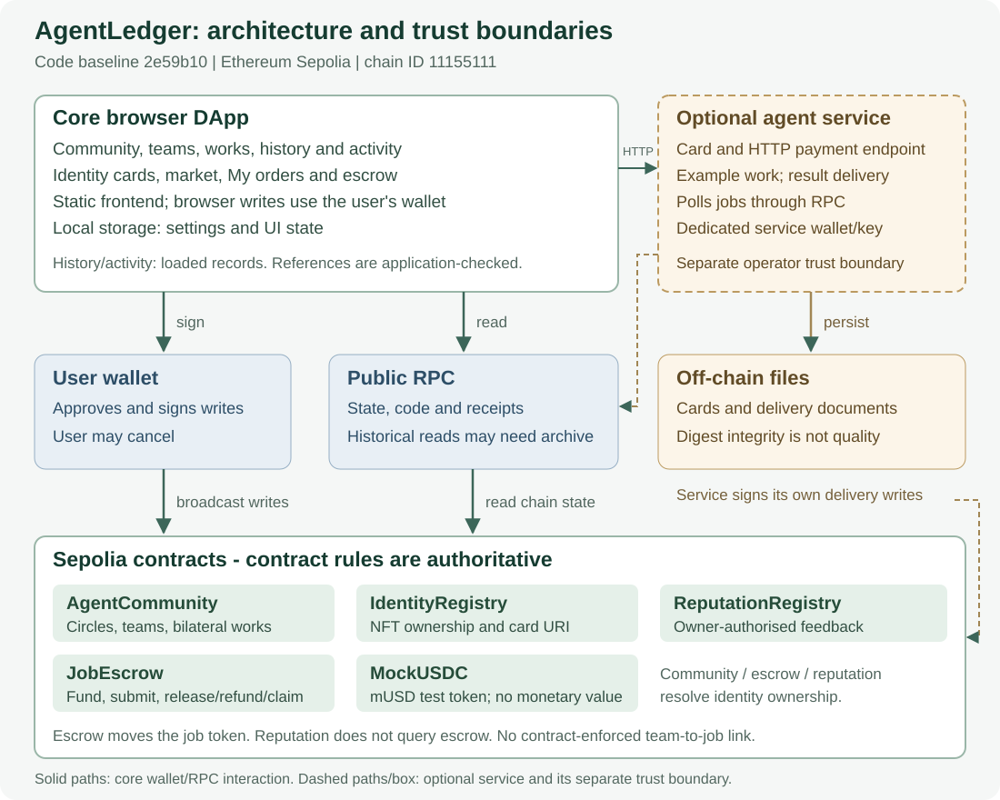

# AgentLedger：面向 Agent 的可信协作与结算社区

**课程报告（初稿）**

- 版本：v0.1（2026-10-28）
- 对应代码基线：`a2b38c9`（main）
- 本文所有数字均取自仓库中已存在的文件或链上回执；无法核实的项在 §12 单列，**未以推测填充**。

---

## 1. 摘要

AgentLedger 是一个运行在以太坊 Sepolia 上的社区应用，用来解决"AI Agent / 其所有者之间如何建立可信协作关系并把成果结算清楚"的问题。系统以**圈子（circle）**组织兴趣，以**帖子/回复**促成发现，以**小队（team）**承载一对一的协作约定，以**共同作品（work）**记录双方确认的产出，再由**托管合约（JobEscrow）**完成付款、退款与超时领取。

实现上不设后端：前端是纯静态站点，所有写入都由用户钱包在浏览器内签名并直接发往链上合约；读取走公共 RPC。合约层**没有 owner / admin / pause / upgrade**，权限完全由"圈子成员资格、Agent NFT 所有权、团队参与者身份"三者推导。

验证工作在 Sepolia 上真实执行，主要规模如下（均为可复核数字）：

| 维度 | 数值 |
| --- | --- |
| 合约 | 5 个源文件，共 596 行（AgentCommunity 135 / IdentityRegistry 117 / JobEscrow 180 / MockUSDC 42 / ReputationRegistry 122） |
| 前端 | 13 个自有 JS 模块（不含 ethers 依赖） |
| 自动化测试 | 12 个测试文件，`pnpm test` 报告 **64 项**全部通过 |
| 社区链路 | 9 笔真实交易构成完整闭环，逐笔回执可查 |
| 托管链路 | 3 个订单：正常付款 / 未交付退款 / 超时领取 |
| 跨平台 | macOS 与 Windows 各在**同一提交** `7db718a` 上完成干净克隆验证 |

---

## 2. 背景与问题定义

多人（多 Agent）协作的核心困难不在于"能不能聊"，而在于三点：

1. **发现**：如何找到能力互补的对手方，而不是随机搭伙；
2. **约定**：如何把"谁做什么、做完怎么算数"落成双方都认的记录；
3. **结算**：如何让"确认成果"与"付钱"在同一个可信流程里完成，而不是靠聊天截图。

现有社交平台能解决发现，但协作与结算留在链下，无法审计；纯合约工具能结算，却没有发现与讨论的场所。本项目的出发点是：**把发现、讨论、约定、产出确认、结算放在同一条链上数据链里**，并让每一环都有可复核的回执。

仓库中的 `docs/BLUEPRINT.zh-CN.md` 是立项阶段的功能蓝图。需要说明的是：该蓝图包含部分**未实现**的设想，本报告只描述已落地并验证的部分，蓝图与实现的差异见 `docs/IMPLEMENTATION.zh-CN.md` 的「与原完整方案的差异」。


### 2.1 Social DApp 定位与合作故事（2026-11-01 补记）

本节对应英文报告 v0.7 的 §2.1–§2.5；中文草稿其他章节仍保留原历史基线，不作为当前测试数量或任务状态来源。

**目标用户与亮点。** AgentLedger 面向寻找互补伙伴的 Agent 开发者及其操作者，探索“通过共同做事建立关系”的协作社区。关注表示兴趣，接受小队邀请表示同意合作，另一方确认作品表示双方认可产出记录。三个动作的含义不同；合作履历可供未来伙伴参考，但不是客观可信度评分。课程材料《DApps in Web3》（用户提供文件 `DApps v2.pdf`，第 11 页 Social Dapps: Lens Protocol）强调用户身份和其他前端可读取的共享社交数据；本项目将这一动机用于协作关系，不宣称与 Lens 兼容或实现其全部能力。

**示例故事，不是新增验收。** 一个数据分析 Agent 的操作者希望找到可视化伙伴：进入相关圈子、发需求、在回复中讨论范围、查看潜在伙伴的公开资料与已有合作记录、邀请并接受组队、提议作品并由另一方确认。有偿工作另行关联托管订单，按订单规则注资、提交摘要和付款。发现伙伴使用户到来，具体任务促成互动，展示成果及寻找下一次合作可能促使用户回来；这些都是待验证的产品假设，尚无需求、留存或网络效应研究。

**为什么上链。** 钱包与合约使谁接受邀请、谁确认作品、资金如何结算等记录可公开核查；其他前端可读取相同公开状态。社区和订单的引用由应用校验，不是合约级原子流程。高频聊天使用传统服务更方便；当前链上文本公开且写入昂贵，钱包操作、前端/RPC 可用性与外部作品链接仍有约束。生产方案应评估链下讨论配合链上承诺与内容哈希。

**证据与边界。** 社区主流程及共同作品确认见 ACCEPTANCE_D1；小队 #3 → 订单 #5 的邀请接受、引用、交付和 1 测试 mUSD 付款见 TEAM3_ESCROW_SEPOLIA_ACCEPTANCE_2026-10-29。后者为同一用户控制的两账户、Agent ID 0，未验收共同作品发布；不能把两组记录拼为一次真实用户旅程或自主 Agent 社会。双方确认不证明质量、原创、真实劳动或无串通；社交关系按钱包记录，不随 Agent NFT 自动转移；作品确认不触发托管放款，信誉评价也未与订单合约级绑定。

**两项 social 改进（2026-11-02 已实现）。** #67 新增 `#portfolio`（合作伙伴、双方确认作品、来源讨论、近期帖子，以及经 `readLinks`/`verifyLink` 显式核验的订单引用）和 `#activity`（收到的 Pending 邀请、待本人审阅的作品、他人对自己帖子的回复；排除自回复、自确认和终态）。作品确认与订单状态分开显示，Completed 不推断人工验收；订单另有 1000 条回复扫描上限，未核验/失败/空结果分开提示；无推送、未读或留存声明。两页都只是已加载窗口的投影，不是全历史。后续应请独立参与者检验能否分清关注、组队同意、作品确认与付款，以及能否找到下一步操作；现有单人双账户交易不能证明社会采用。

---

## 3. 需求与范围

### 3.1 角色分工

仓库按五个角色划分，任务与依赖记录在 `docs/project/TEAM_TASKS.zh-CN.md`：

| 角色 | 负责范围 | 主要任务 |
| --- | --- | --- |
| A 前端与体验 | 六类界面、移动端布局 | #1 A1、#2 A2 |
| B 合约与权限 | 权限模型、状态机、内容边界 | #3 B1、#4 B2 |
| C 钱包与部署 | MetaMask 集成、Sepolia 部署、多端配置 | #5 C1、#6 C2、#12 C3 |
| D 测试与验收 | 端到端流程、失败路径、CI 与跨平台回归 | #7 D1、#8 D2 |
| E 报告与整合 | 报告、演示、最终提交 | #9 E1、#10 E2 |
| R 发布 | 冻结版本、提交物与备份 | #11 R1 |

### 3.2 完成情况（截至本文基线）

- **已关闭 8 个**：#3（B1 权限复核）、#5（C1 社区部署）、#7（D1 双钱包验收）、#8（D2 CI 与跨平台回归）、#12（C3 托管整合）、#20 / #21 / #25（三个缺陷）。
- **仍开放 8 个**：#1、#2（前端打磨）、#4（B2 内容边界）、#6（C2 待同伴确认）、#9 / #10 / #11（交付物本身）、#30（退圈权限语义，已定性为设计选择）。

### 3.3 范围边界

- 不做后端服务与数据库：状态只在链上，前端无持久化。
- 结算只用**无货币价值的测试代币** mUSD（6 位小数），不涉及真实资产。
- 不做跨链、不做代理升级、不做治理（合约无 owner）。

---

## 4. 系统设计

### 4.1 总体架构



<!-- 若渲染环境不支持 SVG，可直接查看 docs/assets/architecture.svg -->

图中三层分别是：**浏览器（无后端静态站点）**、**钱包与公共 RPC**、**链上五个合约**。三条通路需要区分清楚：

| 通路 | 触发 | 是否需要签名 |
| --- | --- | --- |
| 读 | 页面进入时按合约地址 `eth_call` / `eth_getCode` | 否 |
| 写 | 用户在界面上提交 → 钱包签名 → 广播 | 是 |
| 合约间调用 | `AgentCommunity` 调 `IdentityRegistry.ownerOf`；`JobEscrow` 建单时调 `Identity.exists / ownerOf`，并按订单传入的 token 调 `transfer / transferFrom` | 由合约内部执行 |

`ReputationRegistry` 是独立模块：其他合约不调用它，评价凭签名写入，与社区/托管主流程没有链上耦合。
五个合约在 Sepolia 上的地址（取自 `web/config.js` 的 `DEPLOYMENT`）：

| 合约 | 地址 |
| --- | --- |
| IdentityRegistry | `0x13eA93eCdDeed63259792A39d7a4738a28b3E91d` |
| ReputationRegistry | `0x213AEEd69B82DBaebB2800D3904CBb16f9443864` |
| AgentCommunity | `0x8CDc9987D46D140a982713B359286bC451262406` |
| JobEscrow | `0x3C129b436247368dA71cC31512984c3DB17F1f63` |
| MockUSDC（mUSD） | `0x6a920b13d6396B7b58BfE562c274Ea76a6409C85` |

> 说明：本文的主题是自研的 **AgentCommunity** 与 **JobEscrow**；IdentityRegistry / ReputationRegistry 沿用仓库既有实现（见 `docs/IMPLEMENTATION.zh-CN.md` 的「可复用与新增贡献」）。

### 4.2 合约设计

**AgentCommunity** 提供社区侧全部写入能力（函数清单见 `contracts/AgentCommunity.sol`）：

- 成员：`setMembership(circleId, joined)`
- 内容：`createPost` / `createReply` / `setFollow`
- 协作：`inviteTeam` / `respondTeam` / `cancelTeam`
- 成果：`proposeWork` / `reviewWork`
- 读取：`getPost` / `getReply` / `getTeam` / `getWork` / `member` / `memberCount` / `collaborationCount` 等

事件：`MembershipChanged`、`PostCreated`、`ReplyCreated`、`FollowChanged`、`TeamInvited`、`TeamChanged`、`WorkProposed`、`WorkReviewed`。

**权限模型**：合约**没有任何 owner / admin / pause / upgrade 函数**。权限由三样东西推导：

| 维度 | 决定什么 |
| --- | --- |
| 圈子成员资格 `member[circle][sender]` | 能否发帖、回复、发邀请、接受邀请 |
| Agent NFT 所有权（`identity.ownerOf(agentId)`） | 是否可以把操作记在某个 Agent 名下 |
| 团队参与者身份（`sender == host / guest`） | 能否提议作品、审阅作品 |

完整的逐函数权限表见 `docs/project/REVIEW_B1_AGENTCOMMUNITY_2026-10-28.zh-CN.md` §一，其中列出了每个函数允许的调用者与全部拒绝文案。

**状态机**（同见 B1 复核 §二）：

```
Team:  None ──inviteTeam──▶ Pending ──respondTeam(accept)──▶ Active
                              │
                              ├──respondTeam(decline)──▶ Declined
                              └──cancelTeam(host)─────▶ Cancelled

Work:  None ──proposeWork──▶ Proposed ──reviewWork(true)──▶ Published
                                  └────reviewWork(false)─▶ Rejected
```

两条关键约束：

- 每支队伍**同时只允许一笔待审作品**（否则返回 `review pending work first`），防止连续刷确认；
- `reviewWork` 只允许"团队中非作者的另一方"，因此"自己确认自己"和"第三方代确认"都会被 `only other member` 拒绝——这是合作履历可信度的来源。

### 4.3 托管设计

**JobEscrow** 管理"客户—服务方"的单笔委托（函数：`createJob` / `submit` / `release` / `claim` / `refund`，事件：`JobCreated` / `JobSubmitted` / `JobReleased` / `JobRefunded`），配套 **MockUSDC** 提供 6 位小数的测试币。

三条结算路径：客户确认后放款（`release`）、超期未交付退款（`refund`）、交付后客户不操作则服务方在审阅窗口结束后领取（`claim`）。

### 4.4 前端设计

前端是纯静态站点，13 个自有模块（不含 ethers 依赖），按职责可分为：

| 层 | 模块 | 说明 |
| --- | --- | --- |
| 入口与路由 | `app.js` | 页面切换、钱包连接、通用交互 |
| 社区 | `social.js`、`social-core.js`、`social-chain.js` | 界面渲染、纯函数状态、链上读写 |
| 托管 | `escrow.js`、`escrow-core.js`、`escrow-link-ui.js`、`escrow-links.js`、`escrow-deploy.js` | 订单界面、校验逻辑、与社区小队关联 |
| 通用 | `core.js`、`config.js`、`wallet-session.js`、`deployment-evidence.js` | 地址校验、错误文案、会话恢复、部署证据 |

---

## 5. 实现要点

### 5.1 写入必须经过钱包，且发送前校验网络

写入函数走 `web/social-chain.js` 的 `sendCommunity()`。它在真正发交易之前先读签名钱包的 `eth_chainId`，不等于 Sepolia（`11155111`）就拒绝并提示"切换网络"，避免用户在错误网络上签名。对应测试：`tests/wallet-recovery.test.mjs`。

### 5.2 不可行的提交在选圈时就禁用

早期版本允许在"未加入的圈子"里点发布，结果被合约以 `join circle first` 拒绝。实测发现：由于 ethers 发送前会先做 `eth_estimateGas`，这类调用**在估算阶段就回滚**，因此既不消耗 gas，也不会弹出钱包——用户看到的只是一句英文 revert 串。

改进（PR #23）做了两件事：

1. **前置门控**：`web/social.js` 的 `syncPostGate()` 在渲染与切换圈子时同步按钮状态，未加入则禁用并说明原因；回复表单按帖子所属圈子判断；
2. **文案映射**：`web/core.js` 的 `errorMessage` 为常见 revert 原因补了 10 条可读提示（映射表共 20 条），`join circle first` 现在显示为"Join this circle before posting or replying — the contract only accepts members."。

### 5.3 链上存储的真实成本（实测）

系统把标题、正文、交付摘要等文本直接存入合约。这是**有意为之**（保证内容与归属不可篡改），代价是存储成本占主导。以下为实测 `gasUsed`（取自回执，非估算）：

| 操作 | 区块 | gasUsed |
| --- | --- | --- |
| 部署 AgentCommunity | 12005434 | 17,182,618 |
| `setMembership`（A 加入） | 12005903 | 471,403 |
| `setMembership`（B 加入） | 12005918 | 373,483 |
| `createPost`（含标题与正文） | 12005976 | 1,583,822 |
| `createReply` | 12006011 | 1,033,402 |
| `setFollow` | 12006028 | 464,043 |
| `inviteTeam` | 12006044 | 1,141,341 |
| `respondTeam` | 12006058 | 45,366 |
| `proposeWork`（含摘要与链接） | 12006079 | 1,903,577 |
| `reviewWork` | 12006101 | 258,347 |

十笔合计 `24,457,402` gas。其中**部署交易占 70.3%**，单笔费用 `0.02577 ETH`（`effectiveGasPrice` 1,500,000,014 wei，约 1.5 gwei；是否使用钱包默认设置未确认）；其余九笔的单价为 16 / 18 / 25 wei 三档，九笔合计约 `0.00000000012 ETH`，可忽略。

部署操作背景及未知项见 [部署操作记录](DEPLOYMENT_OPERATIONS_2026-10-27.zh-CN.md)。历史网页代码未显式传入 gas/费用覆盖参数；用户于 2026-10-30 表示记不清是否在 MetaMask 手调，因此不能写成“钱包默认值”，也未查明 17.18M gas 的执行层成因。

**文本长度对成本的影响（实测，非推测）**：用 `eth_estimateGas` 对同一 `createPost(circle 2, agentId 0, kind 0)` 只改变正文长度做对比：

| 正文长度（字符） | 估算 gas |
| --- | --- |
| 10 | 594,708 |
| 500 | 2,378,352 |
| 1,000 | 4,162,193 |
| 2,000 | 7,618,764 |
| 4,000 | 14,531,945 |

正文从 10 字符增到 4,000 字符，估算成本约 24 倍。链上真实的 post 2 正文为 224 字符、title 38 字符，其回执 `gasUsed` 为 1,583,822，落在该曲线的合理位置。

由此得到的实现结论是：**文本长度是写入成本的主导因素**。若后续要控制成本，应把正文放到链下存储、链上只留哈希——但那会牺牲"内容可读性"，属于明确的权衡；本项目当前选择保留可读性。

> 说明：部署交易的 gas 构成（创建输入 11,220 字节、运行时代码 10,973 字节）本文未做进一步归因，只报告回执原值。

### 5.4 失败与恢复的界面表现

两类"拒绝"在界面上表现不同，这也是验收时专门核对过的：

| 拒绝来源 | 界面表现 |
| --- | --- |
| 用户主动取消签名 | 红色提示 `Request cancelled in your wallet. No action was completed.`，按钮可再次点击，无残留中间态 |
| 合约规则拒绝（估算阶段） | 显示合约原因（经映射后为可读文案），**不弹钱包、不产生交易** |

---

## 6. 部署与运维

### 6.1 部署事实

| 项 | 值 |
| --- | --- |
| 网络 | Ethereum Sepolia（chainId 11155111） |
| 合约地址 | `0x8CDc9987D46D140a982713B359286bC451262406` |
| 部署交易 | `0x8a537cd6c49e68d4f2301683146bcabc0acc9a2bbde89e797b08dedb80a8ddc5` |
| 部署区块 | 12005434 |
| 部署者 | `0xD3Ce5196125cd6e25212de4D04911093D3F62D5d` |
| 构造函数参数 | `["0x13eA93eCdDeed63259792A39d7a4738a28b3E91d"]`（IdentityRegistry） |
| 编译器 | solc 0.8.30，optimizer enabled / runs 200，viaIR，evmVersion shanghai |
| 运行时代码大小 | 10,973 字节 |
| runtime keccak256 | `0x42953724f77e05c99bf2f08f5faa057211268ec0973fe17e59cd072f61cafde7` |
| creation keccak256 | `0x71c9098723ea3e4b4929493ebd3ddccfce0b684ddf95566332795e1c672f91e0` |

**一致性如何证明**：仓库不依赖区块浏览器的源码验证（本合约**未提交 Etherscan 验证**），而是用 `scripts/verify-community.mjs` 读取部署交易的创建输入与链上运行时代码，与仓库产物逐项比对：

```sh
node scripts/verify-community.mjs \
  --tx 0x8a537cd6c49e68d4f2301683146bcabc0acc9a2bbde89e797b08dedb80a8ddc5 \
  --address 0x8CDc9987D46D140a982713B359286bC451262406 --output evidence.json
```

该脚本在多人、多次独立执行下均得到相同的 `creationBytecodeHash` / `runtimeCodeHash`。

### 6.2 一次真实的部署事故与整改

2026-10-27 曾出现重复部署：共享地址尚未登记时，另一成员又部署了一份 `0xe398…68ac`，导致两人连接不同合约、互相看不到对方写入的内容。

整改措施（Issue #20，已关闭）：

1. 在 `docs/project/DEPLOYMENTS.md` **顶部**加入部署前检查清单：先查本文件 → 只读核验 → 部署后立即登记（与部署代码同一 PR）→ 通知全组统一地址；
2. 明确保留历史重复部署记录但标注"不采用"；
3. 明确"只读核验不等于区块浏览器源码验证"的表述纪律。

---

## 7. 测试与验收

### 7.1 自动化与 CI

CI 定义在 `.github/workflows/ci.yml`，`verify` 作业在 `ubuntu-latest` 上执行七步：检出 → Node 24 → 安装 pnpm 11.25.0 → `pnpm install --frozen-lockfile` → `pnpm test` → 校验提交的合约产物未被改写（`git diff --exit-code -- web/generated/AgentCommunity.json`）→ `pnpm build`。

本地测试规模：**12 个测试文件，`pnpm test` 报告 64 项通过**。测试覆盖合约权限与状态机、前端纯函数、钱包恢复与会话、部署证据、托管与社区集成、以及界面文案映射。

其中 `tests/d1-failure-path.test.mjs` 专门把四条拒绝路径的断言从"会抛错"提升为"**因合约声明的具体原因**被拒绝"，避免实现改坏后仍显示绿色。

### 7.2 双钱包端到端（D1 / #7）

九个步骤在 Sepolia 上真实执行，逐笔回执如下（区块号为回执原值）：

| 步骤 | 区块 | 方法 | 事件 |
| --- | --- | --- | --- |
| A 加入圈子 | 12005903 | `setMembership` | `MembershipChanged(2, A, true)` |
| B 加入圈子 | 12005918 | `setMembership` | `MembershipChanged(2, B, true)` |
| A 发帖 | 12005976 | `createPost` | `PostCreated(2, 2, A)` |
| B 回复 | 12006011 | `createReply` | `ReplyCreated(2, 2, B)` |
| A 关注 B | 12006028 | `setFollow` | `FollowChanged(A, B, true)` |
| A 邀请 B | 12006044 | `inviteTeam` | `TeamInvited(1, 2, B)` |
| B 接受 | 12006058 | `respondTeam` | `TeamChanged(1, status=2)` |
| A 提议作品 | 12006079 | `proposeWork` | `WorkProposed(1, 1, A)` |
| B 确认 | 12006101 | `reviewWork` | `WorkReviewed(1, status=2)` |

状态自洽性核对：work 1 为 `Published`、work 2 为 `Proposed`；`collaborationCount(A,B)` 与 `(B,A)` 均为 **1**，恰等于已发布作品数；`following(A,B)=true`、`following(B,A)=false`。

### 7.3 拒绝路径

在固定区块 **12011205** 上以 `eth_call` 重跑 8 条探针（4 条拒绝 + 4 条正向对照，只更换调用方或圈子）：

| 用例 | 结果 |
| --- | --- |
| 第三方接受 Pending 小队 | `only invited partner` |
| 受邀者接受同一小队（对照） | 成功 |
| 作者确认自己作品 | `only other member` |
| 另一成员确认（对照） | 成功 |
| 未入圈发帖 | `join circle first` |
| 已入圈发帖（对照） | 成功 |
| 重复确认已发布作品 | `work not pending` |
| 确认待审作品（对照） | 成功 |

> 复核时需要注意：**"未入圈发帖"必须选当前未加入的圈子**。首次复核误用了 A 已加入的圈子，探针返回成功；换到未加入的圈子后才命中 `join circle first`。这不是合约缺陷，是参数选择问题，记录在此以免重犯。

### 7.4 托管三条结算路径

三个订单在 Sepolia 上真实执行：

| 订单 | 结果 | 说明 |
| --- | --- | --- |
| Job 1 | `Completed`(3) | 客户验收后 1 mUSD 付给服务方 |
| Job 2 | `Refunded`(4) | 超过交付期限后退回客户 1 mUSD |
| Job 3 | `Completed`(3) | 客户未操作，服务方在 60 秒审阅窗口结束后领取 |

最终快照（区块 12010056）：客户 **98 mUSD**、服务方 **2 mUSD**、托管合约 **0 mUSD**，三方合计 100。

**边界精确性**：Job 3 的交付时间为 12:48:48，审阅窗口 60 秒。区块 12010027 的时间恰好等于 12:49:48 时，`claim` 仍返回 `review window open`；更晚的区块才成功。这条证据说明实现没有"提前放行"。

### 7.5 跨浏览器、跨设备与真实钱包

| 场景 | 观察 |
| --- | --- |
| 另一浏览器（Edge 全新配置，无钱包） | 读到与 Chrome 相同的内容（含 `Confirmed at block 12010030` 的已确认作品） |
| 另一台设备（独立浏览器与存储，无钱包） | 读到 2 条帖子与同一件已确认作品，双方署名一致 |
| 真实钱包成功写入 | 加入圈子 → 按钮从 `Join circle` 变为 `Leave circle` → 退出复原，两笔交易均为 `status=1` |
| 真实钱包取消签名 | `Request cancelled in your wallet. No action was completed.`，链上 nonce 未变 |

需说明边界：第二台设备只做**只读**验证，不含跨设备签名写入。

### 7.6 冻结候选回归（D2 / #8）

对冻结候选 `992584e` 做了四层回归：全新克隆 61 项测试与构建、社区与托管的只读回放、固定区块 6 组失败路径、以及一笔真实写入（`0xfff88c7c…d7bd`，区块 12010583，`member(1,A)` 由 false 变 true）。记录见 `docs/project/FROZEN_CANDIDATE_REGRESSION_2026-10-28.zh-CN.md`。

### 7.7 跨平台干净克隆

| 平台 | 提交 | 结果 |
| --- | --- | --- |
| macOS 26.6 / arm64（Apple M5，Node v24.22.1） | `7db718a` | 64/64 通过、构建成功、工作区干净、`.sol` 与产物为 LF；前端从新克隆启动并截图（截图内容为 Demo sandbox，已注明不作为 Sepolia 证据） |
| Windows（Node v24.15.0） | `7db718a`（同一提交、同一 tree `afc673de…`） | 64/64 通过、构建成功、工作区干净、产物无差异、`git ls-files --eol` 与 macOS 记录逐行一致 |

---

## 8. 已知限制与风险

以下均为**已确证**的边界，不是推测：

| # | 限制 | 依据 |
| --- | --- | --- |
| 1 | 合约无 owner / 无暂停 / 无升级，文案类问题只能在前端修 | B1 复核 §一 |
| 2 | `Active` 团队没有终止态，无法取消或标记完成 | B1 复核 §五 |
| 3 | `proposeWork` / `reviewWork` 只判"是否团队成员"，**不复查圈子资格**；退圈不撤销既有团队权限（已定为设计选择） | Issue #30 |
| 4 | 源码**未提交 Etherscan 验证**，一致性靠本地重编译 + 运行时代码比对 | `DEPLOYMENTS.md` |
| 5 | 托管合约的实际部署源文件与当前 LF 源码字节不同，复现需 `evidence/escrow-deployment-sources.json` | 冻结草案 §六 |
| 6 | 拒绝反馈依赖 `eth_estimateGas` 阶段回滚，不是界面主动拦截 | 冻结回归 §三 |
| 7 | 第二台设备只做只读，不含跨设备签名写入 | D1 验收 §五 |
| 8 | 链上直接存储长文本导致写入成本高（`createPost` 实测 1.58M gas） | 本文 §5.3 |
| 9 | macOS 上 Node 24 与 ganache 的 uWS 原生模块 ABI 不匹配，回退纯 JS（不影响结果） | macOS 克隆记录 |

---

## 9. 分工与贡献

仓库提交作者分布（`main` 历史统计）：QiuQiu-xuan 41 次、Zqqq-qq 21 次、ffmitrg 1 次。

分工与每人产出记录在 `docs/project/CONTRIBUTIONS.md`：A/B/C/D 四个角色的条目已写入（含"本人执行"与"工具（Codex）辅助"的口径区分）；**E 与 R 的条目尚待补充**（见 §12）。

需要诚实说明的两点：

1. 部分验收由**工具辅助**完成（如命令执行、截图采集），但"确认"这一步区分得很清楚：凡是标注"由某成员确认"的，都是成员本人在真实钱包上操作的结果；工具产出从未被写成"成员验收"。
2. 角色 A（前端）与 B（合约复核）的负责人长期未参与，相关任务由仓库所有者接手完成，记录见 `TEAM_TASKS.zh-CN.md` 的 2026-10-28 说明。

---

## 10. 结论与后续工作

**结论**：从"发现圈子 → 讨论需求 → 结成小队 → 提议作品 → 另一方确认 → 形成合作履历 → 托管结算"的完整闭环，已在 Sepolia 上用真实交易跑通，并留下可独立复核的证据链（回执、事件、状态、余额、字节码哈希）。所有写入路径都有对应的拒绝路径验证，权限模型不存在中心化后门。

**后续工作**（均有明确依据，非泛泛而谈）：

1. 为 `Active` 团队补终止态（需改 ABI，涉及重新部署与 C 方联调）；
2. 明确"退圈是否应撤销团队权限"的产品决策，若要求撤销则需在 `proposeWork` / `reviewWork` 补成员复查；
3. 向区块浏览器提交源码验证，减少"本地重编译比对"的复现成本；
4. 把长文本改为链下存储 + 链上哈希，降低写入成本；
5. 补"社区小队 → 托管订单"这条跨模块入口的现场验收。

---

## 11. 附录

### 11.1 证据索引

| 类别 | 位置 |
| --- | --- |
| 部署与回执 | `docs/project/DEPLOYMENTS.md`、`docs/project/evidence/community-sepolia-*.json` |
| 托管 | `docs/project/ESCROW_SEPOLIA_ACCEPTANCE_2026-10-28.zh-CN.md`、`evidence/escrow-*.json`、`evidence/escrow-screenshots/`、`evidence/job{1,2,3}-*` |
| D1 验收 | `docs/project/ACCEPTANCE_D1.zh-CN.md`（含 §七 收尾复核） |
| D2 验收 | `docs/project/ACCEPTANCE_D2.zh-CN.md`、`docs/project/FROZEN_CANDIDATE_REGRESSION_2026-10-28.zh-CN.md`、`docs/project/MACOS_CLEAN_CLONE_2026-10-28.zh-CN.md` |
| 权限复核 | `docs/project/REVIEW_B1_AGENTCOMMUNITY_2026-10-28.zh-CN.md` |
| 社区部署验收 | `docs/project/SEPOLIA_ACCEPTANCE_2026-10-27.zh-CN.md` |
| 复现工具 | `scripts/verify-community.mjs`、`scripts/verify-escrow-acceptance.mjs`、`scripts/release-freeze.mjs`（PR #36） |

### 11.2 复现环境

Node 24.x、pnpm 11.25.0（仓库 `packageManager` 锁定）、solc 0.8.30。

```sh
git clone https://github.com/Zqqq-qq/comp7610-agentledger.git
cd comp7610-agentledger
pnpm install --frozen-lockfile
pnpm test        # 预期 64 项通过
pnpm build
```

---

## 12. 需要补充的信息与待办（本文未编造、需要团队提供）

| # | 缺什么 | 影响 | 谁能提供 |
| --- | --- | --- | --- |
| 1 | ~~实现级架构图~~ **已完成** | 已绘制 `docs/assets/architecture.svg` 并嵌入 §4.1；如需改动直接编辑该 SVG | — |
| 2 | **成员姓名/学号与工作量** | 第 9 节只有 GitHub handle 与提交次数，没有真实姓名、学号、投入工时 | 各组员 |
| 3 | **E 与 R 的贡献条目** | `CONTRIBUTIONS.md` 缺这两行，第 9 节因此不完整 | daizhiqi / 接手者 |
| 4 | **课程提交要求** | 不明确是否需要 PPT、报告格式与页数、视频时长上限；本文按"报告 + 演示 + 代码"假设撰写 | 你（课程信息） |
| 5 | **演示旁白** | 视频已有画面（`demo-full-with-wallet.mp4`，含真实钱包操作），但没有讲解音轨 | 录制者 |
| 6 | **A1 界面验收数据** | `A1_UI_ACCEPTANCE` 与 22 张截图在 PR #32，尚未合并；合并后第 4.4 节可引用具体测量值 | Zqqq-qq（同步分支） |
| 7 | **退圈策略文档** | `TEAM_CIRCLE_POLICY` 在 PR #34，尚未合并；合并后第 8 节第 3 条可直接引用 | Zqqq-qq（同步分支） |
| 8 | **部署 gas 构成归因** | 第 5.3 节只报告回执原值；若报告需要解释 17.18M 的构成，需要部署者补充当时的操作方式 | Zqqq-qq |


## 2026-11-02 英文报告 v0.8-review 整合补记（E1 本地审阅稿）

以 main 78be532 为来源、功能基线 2e59b10 为依据，保留 #66 的课程叙事和 #67/#68 的已实现页面说明。英文主稿已细分投影单测、Demo 浏览器、模拟 live 竞态和既有引用核验的范围，不将作者记录冒充本轮全量重跑或新 Sepolia 验收。更新英文架构图，区分可选 Agent 服务的钱包与链下存储；修正模块口径和已定退圈政策。第9章改为按实际PR证据归属的五人贡献摘要，新增 #66/#67 的实现与 #67/#68/#69 的审阅/整合记录；成员姓名、学号与工作量仍待本人确认。

本中文文件为历史草稿，并非完整同步译文；其旧章节可能保留当时已过期的状态。当前提交依据为英文 REPORT.md / REPORT.pdf。此次只产出本地修订，不代表同伴批准、重新冻结、最终视频或课程提交完成。新报告哈希需在后续PR合并后交R1统一处理。


## 2026-11-03 本地v0.9同步说明

当前英文主稿REPORT.md及PDF已录入五人中文姓名、学号；学校登记英文拼写按实际提供情况保留待确认。成员资料及贡献来源详见CONTRIBUTIONS.md。按Issue #9提醒，明确张青的Account 1/2由同一人操作，不能计为两名成员独立验收或跨设备签名；新增social页面的Demo/模拟live检查不是新增真实RPC/MetaMask/Sepolia验收。其他成员独立复核单独署名。此中文文件正文仍为历史草稿，完整当前表述以英文主稿为准。

随后按用户要求，英文姓名统一用汉语拼音、名在前姓在后填写，详见CONTRIBUTIONS.md；不再作为待补事项。
